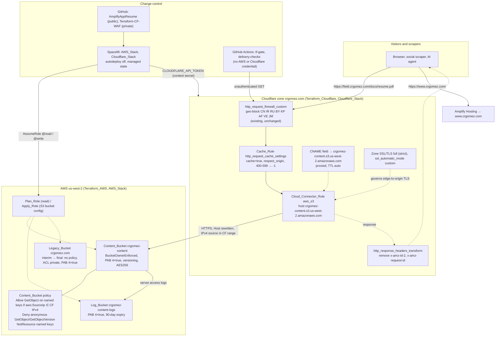
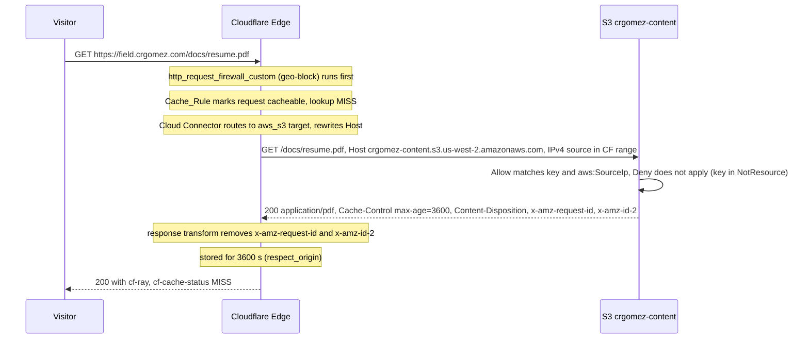
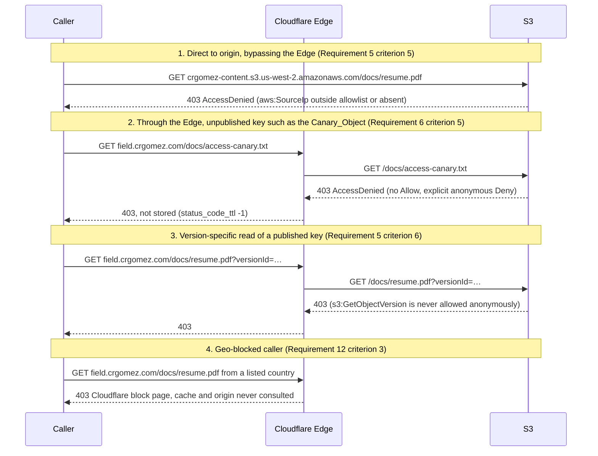
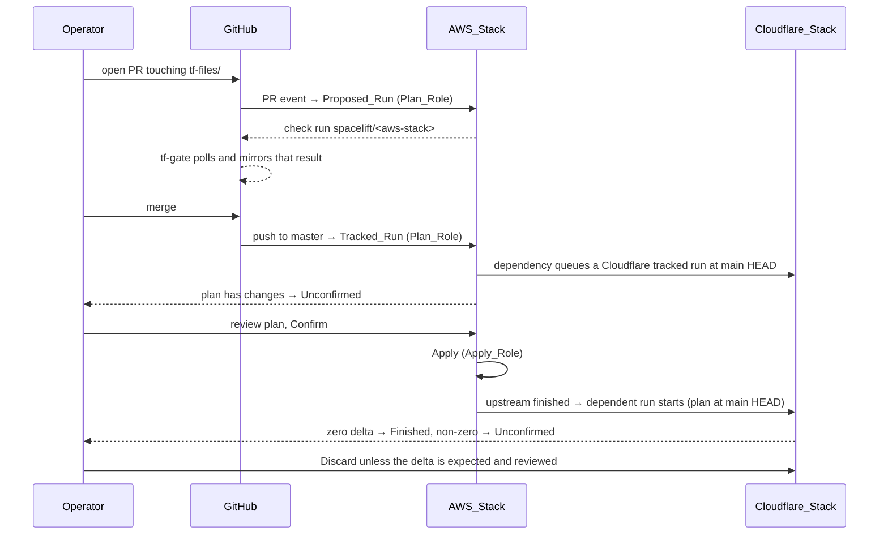

# Design Document

## Overview

This design implements the amended `requirements.md` for `cloudflare-s3-asset-delivery`. It replaces the previous design in full. The previous design's architecture (Origin Rules Host override, Terraform Cloud and GitHub Actions applies, relaxed Public Access Block on the new bucket, an IPv6-normalized allowlist read from `cloudflare_ip_ranges`) is not carried forward.

The end state:

- `https://field.crgomez.com/docs/resume.pdf`, `/img/hero-banner.png`, and `/img/favicon.png` are served by Cloudflare through a Cloud Connector rule from the private-by-default bucket `crgomez-content`. The bucket keeps all four Public Access Block flags `true` for its whole life. Its policy grants anonymous `s3:GetObject` only on those three named keys and only from Cloudflare's 15 published IPv4 prefixes.
- The legacy bucket `crgomez.com` becomes a private archive in three stages: an interim lockdown by AWS CLI (Phase 0), soft deletion of five unreferenced objects (Phase 0), and a final lockdown once `index.html` no longer references it (Phase 2).
- Both Terraform configurations are applied by Spacelift stacks with autodeploy disabled. AWS access uses two IAM roles assumed through Spacelift's native AWS integration, with no static key in the apply path. The Terraform Cloud workspace and the auto-applying GitHub Actions workflow in `Terraform-CF-WAF` are retired.
- The published resume changes content: `crgomez-seceng-ir.pdf` (2026-01-31, 221604 bytes) is published as `docs/resume.pdf`, superseding the stale `crgomez-security-engineer.pdf` (2025-11-02, 482437 bytes).

The feature is infrastructure code plus an operational runbook. The design therefore has no Correctness Properties section; the reason is given in [Testing Strategy](#testing-strategy).

### Design-time verified facts

These facts were supplied by the owner from earlier verification or re-probed for this revision. Probes were unauthenticated.

| Fact | Value | Used by |
| --- | --- | --- |
| Regional S3 endpoint address families | `s3.us-west-2.amazonaws.com`: 8 A, 0 AAAA. `s3.dualstack.us-west-2.amazonaws.com`: 8 A, 8 AAAA | Requirement 5 criteria 3 and 12 |
| Cloudflare IPv4 list | 15 prefixes, widths `/13` (2), `/14`, `/15`, `/17`, `/18` (2), `/20` (3), `/22` (5). Re-fetched for this revision: identical set | Requirement 5 criteria 3, 8, 11 |
| `crgomez-content` name | Unclaimed globally at the previous design (`NoSuchBucket`) | Requirement 3 criteria 1 and 11 |
| Anonymous S3 error bodies | `AccessDenied` carries no bucket name; only `NoSuchBucket` does | Requirement 6 criterion 5 |
| Legacy_Bucket today | ACL `READ` to AllUsers; policy allows `Principal: "*"` `s3:ListBucket` and `s3:GetObject`; no Public Access Block; no ownership controls; SSE-S3; versioning enabled; 9 current objects, 10 versions; every object owned by the bucket owner canonical ID; missing key answers `404` | Requirements 1, 2, 11 |
| Apex and `www` | `https://crgomez.com/` returns `302` to `www` with `x-amz-cf-id` and `via: … (CloudFront)` present, so the apex is **proxied to the Amplify CloudFront origin**, not redirected at the Edge. `www` returns `200`, `cf-cache-status: DYNAMIC` | Requirement 6 criterion 15 (the apex check applies) |
| `field.crgomez.com` | No DNS record today | Requirement 6 criterion 1 |
| `index.html` references | Exactly seven `https://s3.us-west-2.amazonaws.com/crgomez.com/` URLs at lines 24, 25, 36 (`hero-banner.png?v=2`), 44 (`amplify.png`), 84, 116, 439 (`crgomez-security-engineer.pdf`). The three resume anchors have visible text "Resume". `og:url` and `twitter:url` name `https://crgomez.com/` | Requirement 7 |
| Amplify publishes repository files | During this revision, files in the repository other than the site, including Amplify configuration and at least one file under `tf-files/`, were served from `www.crgomez.com` with HTTP `200`; other `tf-files/` files and dot-directories returned the `404` HTML fallback. The probed paths are kept in Operator Records only | Risk R-8, open item A-8 |
| Current `tf-files/` | No `required_providers`, no lock file, `var.acl_value` defaults to `public-read`, inline `acl` on `aws_s3_bucket`, separate `aws_s3_bucket_versioning`, S3 backend `crgomez.com-state` key `crgomez/terraform.tfstate` without `encrypt` | Requirements 13 and 16 criterion 7 |
| Scanner baseline | checkov 12 passed, 1 failed (`CKV_AWS_283`); trivy `AWS-0086`, `0087`, `0091`, `0092`, `0093`, `0094`, `0132`, `0089`, `0320` | Requirement 13 criterion 6 |

### Research findings that shape the design

Each finding is cited and applied in the section named. Content was rephrased for compliance with licensing restrictions.

1. **Spacelift's Terraform FOSS workflow tool stops at Terraform 1.5.7**, the last MPL release ([stack settings](https://docs.spacelift.io/concepts/stack/stack-settings), [supported tools](https://spacelift.io/blog/spacelift-supported-tools-and-frameworks)). Config-driven `import` blocks exist from 1.5; `removed` blocks need 1.7 ([Spacelift upgrade guide summary](https://spacelift.io/blog/terraform-version-upgrade), [Terraform removing resources](https://developer.hashicorp.com/terraform/language/resources/syntax#removing-resources)). The design uses a `moved` block (Terraform 1.1+, [refactoring](https://developer.hashicorp.com/terraform/language/modules/develop/refactoring)) as the "equivalent declarative construct" Requirement 13 criterion 12 allows. See open item A-1.
2. **Push policies are paid-only** ([push policy](https://docs.spacelift.io/concepts/policy/push-policy); the [pricing page](https://spacelift.io/pricing) lists "Policy as Code engine" under Starter). Without a push policy, Spacelift sends no commit status for a push it ignores; the `notify` rule that would send one is a push-policy rule. A Site-only pull request therefore receives no AWS_Stack status on the Free plan, so branch protection cannot require the Spacelift check directly. The design adds a gate workflow; see open item A-2.
3. **Fork pull requests trigger no Spacelift run by default**; allowing them takes an explicit `allow_fork` push-policy rule ([push policy, "Allow forks"](https://docs.spacelift.io/concepts/policy/push-policy)). The Free plan therefore satisfies Requirement 15 criterion 12 by default.
4. **Trigger scoping without policies** uses the stack project root plus optional project globs ([stack settings, project root and globs](https://docs.spacelift.io/concepts/stack/stack-settings)). AWS_Stack sets project root `tf-files/` and no globs.
5. **Spacelift-managed state can only be chosen at stack creation**, and an existing state file can be imported at that point; any `backend` block makes initialization fail ([state management](https://docs.spacelift.io/vendors/terraform/state-management)). Stacks are therefore created with the imported state before the migration Change_Units merge. See open item A-6.
6. **Read and write attachments.** Read attachments are used for Initialize and Plan; write attachments for Apply, task Perform, and destructor Destroy. Spacelift passes an External ID of the form `<account>@<integration-id>@<stack-slug>@read|write`. The trusted principal is a Spacelift-owned AWS account, and Spacelift uses different accounts for EU-hosted (`spacelift.io`) and US-hosted (`us.spacelift.io`) tenants. The design therefore commits no value: the Operator reads the principal from the Spacelift integration screen and supplies it as `var.spacelift_aws_account_id` ([AWS integration setup](https://docs.spacelift.io/getting-started/integrate-cloud/AWS), [AWS integration](https://docs.spacelift.io/integrations/cloud-providers/aws), [Cloud integrations announcement](https://spacelift.io/blog/spacelift-cloud-integrations)).
7. **Stack dependencies queue a dependent tracked run whenever the upstream stack gets a tracked run**, and a failed upstream run cancels the chain ([stack dependencies](https://docs.spacelift.io/concepts/stack/stack-dependencies)). A tracked run with no changes goes straight to finished; one with changes waits as unconfirmed when autodeploy is off ([tracked runs](https://docs.spacelift.io/concepts/run/tracked)).
8. **Cloudflare provider v4.** `cloudflare_cloud_connector_rules` was added in v4.41.0 and changed from set to list in v4.52.0. Rule fields are `expression`, `provider` (`aws_s3`), `enabled`, `description`, and `parameters { host }` ([v4.52.10 resource doc](https://github.com/cloudflare/terraform-provider-cloudflare/blob/v4.52.10/docs/resources/cloud_connector_rules.md), [CHANGELOG](https://github.com/cloudflare/terraform-provider-cloudflare/blob/v4.52.10/CHANGELOG.md)). The latest v4 release is 4.52.10. The v4 ruleset schema places no lower bound on `status_code_ttl.value`, so `-1` validates. `cloudflare_zone_settings_override` restores the captured `initial_settings` for the overridden keys on destroy, and it reads zone details on refresh (provider source, `resource_cloudflare_zone_settings_override.go`). Both configurations pass `terraform validate` under Terraform 1.5.7 with `aws` 6.73.0 and `cloudflare` 4.52.10.
9. **Cache rule TTL semantics.** In `status_code_ttl`, `0` means no-cache and `-1` means no-store; `respect_origin` honors the origin `Cache-Control` ([cache rule settings](https://developers.cloudflare.com/cache/how-to/cache-rules/settings/)).
10. **Cloud Connector.** It requires a proxied record, rewrites `Host`, applies no caching, is evaluated last and wins over earlier rules that changed the same setting, and is described as needing a publicly accessible bucket. The page title carries "(Beta)" while the availability table says GA on all plans with 10 rules on Free ([Cloud Connector](https://developers.cloudflare.com/rules/cloud-connector/)). The providers page says subdomain-style S3 hostnames connect over HTTPS under Full or Full (strict), requires dot-free bucket names for Full (strict), and suggests restricting the bucket to Cloudflare IP addresses ([supported providers](https://developers.cloudflare.com/rules/cloud-connector/providers/)).
11. **Phase order.** `http_request_firewall_custom` runs before `http_request_cache_settings` and `http_request_cloud_connector` ([phases list](https://developers.cloudflare.com/ruleset-engine/reference/phases-list/)).
12. **Automatic SSL/TLS.** Zones may be in an automatic encryption-mode setting (`ssl_automatic_mode = auto`) that upgrades the mode on its own and never downgrades; setting it to `custom` opts out. The same page notes that a configuration rule can set the mode per hostname instead of zone-wide ([encryption modes](https://developers.cloudflare.com/ssl/origin-configuration/ssl-modes/)).
13. **Cloudflare token permission groups** ([API token permissions](https://developers.cloudflare.com/fundamentals/api/reference/permissions/)): zone-level `DNS Write`, `Zone Settings Edit`, `Zone WAF Edit`, `Cache Rules Edit`, `Transform Rules Edit`, `Cloud Connector Edit`, and `Zone Read`. Zone Read is needed because `cloudflare_zone_settings_override` reads zone details. See open item A-4.
14. **GitHub branch protection** is available for private repositories only on paid GitHub plans; on GitHub Free it covers public repositories only ([about protected branches](https://docs.github.com/en/repositories/configuring-branches-and-merges-in-your-repository/defining-the-mergeability-of-pull-requests/about-protected-branches)). See open item A-3.
15. **AWS public-policy evaluation.** A policy conditioned on `aws:SourceIp` is non-public unless a range is broader than `/8` (IPv4) or `/32` (IPv6) ([Blocking public access, "The meaning of public"](https://docs.aws.amazon.com/AmazonS3/latest/userguide/access-control-block-public-access.html)). `aws:PrincipalType` is `Anonymous` for unsigned requests ([global condition keys](https://docs.aws.amazon.com/IAM/latest/UserGuide/reference_policies_condition-keys.html#condition-keys-principaltype)). A `BucketOwnerEnforced` log destination needs a bucket policy for `logging.s3.amazonaws.com` ([enable server access logging](https://docs.aws.amazon.com/AmazonS3/latest/userguide/enable-server-access-logging.html)). S3 bucket-level API calls are CloudTrail management events ([S3 CloudTrail events](https://docs.aws.amazon.com/AmazonS3/latest/userguide/cloudtrail-logging-s3-info.html)), and Event History keeps 90 days ([viewing events](https://docs.aws.amazon.com/awscloudtrail/latest/userguide/view-cloudtrail-events.html)).
16. **`aws_s3_bucket.acl` is Optional and Computed** in provider v6 and is deprecated; removing it from configuration produces no diff (provider source `internal/service/s3/bucket.go`). The v6 upgrade guide changes nothing else this configuration uses ([v6 upgrade guide](https://github.com/hashicorp/terraform-provider-aws/blob/main/website/docs/guides/version-6-upgrade.html.markdown)).

### Owner-overridable design decisions

| ID | Decision | Rationale | Alternative |
| --- | --- | --- | --- |
| O-1 | Define both Spacelift stacks, integrations, and the context **in the UI**, with the configuration recorded in [Spacelift configuration](#spacelift-configuration) | No third stack on the Free plan; the stack that would manage stacks would itself need an admin credential and its own bootstrap | An administrative stack using the `spacelift` provider gives drift visibility and reviewable diffs at the cost of a third stack and a Spacelift API credential in it |
| O-2 | Workflow tool **Terraform FOSS 1.5.7** | Requirements are written against Terraform; 1.5.7 supports `import` and `moved` | OpenTofu vendor (supports `removed` blocks), at the cost of renaming every `terraform` command in the requirements |
| O-3 | Negative_Access_Test lives **outside the repository** as an Operator tool; its full source is in this document | Phase 0 runs it before any pull request exists, and Requirement 16 criterion 2 admits no other path in infrastructure Change_Units. No amendment needed | Commit it under `tf-files/tests/`, which is inside the infrastructure path but would trigger no-op AWS_Stack runs |
| O-4 | Negative_Access_Test in **Python 3 standard library** | CIDR membership (Requirement 11 criterion 7) and header assertions are awkward in POSIX shell; `urllib` never reads AWS credentials | `curl` plus POSIX shell |
| O-5 | The Published_Document list and Cloudflare_Range_Allowlist are **JSON files under `tf-files/`** read by Terraform with `jsondecode(file())` | One source of truth read by Terraform, the Synthetic_Check, the Range_Drift_Workflow, and the Negative_Access_Test; a script can rewrite JSON safely | HCL `locals`, which a workflow cannot edit safely |
| O-6 | Range_Drift_Workflow **opens an issue**, not a pull request | Needs `issues: write` only; a pull request needs `contents: write` plus the repository setting that lets Actions create pull requests | Pull request mode, allowed by Requirement 5 criterion 16 |
| O-7 | Log_Bucket `crgomez-content-logs`, log prefix `crgomez-content/` | Dot-free, names the source | Any dot-free name |
| O-8 | Integration roles `spacelift-crgomez-plan` and `spacelift-crgomez-apply` | Readable in CloudTrail | Any name |
| O-9 | Set `ssl_automatic_mode = "custom"` with `ssl = "strict"` | Keeps Cloudflare's automatic scanner from changing a Terraform-managed value | Leave automatic mode on; it never downgrades |
| O-10 | Add `abort_incomplete_multipart_upload` (7 days) to both lifecycle configurations | Remediates `CKV_AWS_300` per Requirement 13 criterion 9 at no cost | Record an accepted exclusion |
| O-11 | Stack label `feature:ignore_runtime_config` on both stacks | A pull request cannot change the runner image, hooks, or project root through `.spacelift/config.yml` | Allow runtime config |
| O-12 | Cache purges use the Cloudflare dashboard or a separate local token holding only `Cache Purge` on the zone | Keeps purge authority out of Spacelift | Add Cache Purge to the Spacelift token (requires amending Requirement 15 criterion 20) |
| O-13 | Identifiers are variables with a live account guard. Terraform_AWS declares `var.aws_account_id` (exactly 12 digits, no default), builds every account-bearing ARN from it, and sets `allowed_account_ids = [var.aws_account_id]` in the `aws` provider, so the provider refuses to plan or apply against any other account. AWS_Stack supplies it as the non-secret environment variable `TF_VAR_aws_account_id`; local `terraform validate` and `plan` take it from `~/crgomez-ops/config.env`. Spacelift's AWS principal is `var.spacelift_aws_account_id` with no default, read from the Spacelift integration screen. Operator scripts source `config.env` (`EXPECTED_ACCOUNT_ID`, `EXPECTED_CANONICAL_ID`, `AWS_PROFILE_NAME`, `AWS_REGION`), which is written from live reads and confirmed by the owner before Phase 0; `lib.sh` aborts unless the live `sts get-caller-identity` account equals `EXPECTED_ACCOUNT_ID` | The repository is public and indexed by a third party (Greptile), so it carries no literal account ID or canonical user ID. The target is still named at approval time: it is read live and checked against an expected value the owner confirmed, and a guard is only meaningful because a human confirmed what it expects | Literals in the repository, which name the target without a lookup but publish the identifiers |

### Owner decisions still open (pending)

| ID | Question | Proposed default | Status |
| --- | --- | --- | --- |
| D-1 | Scanner_Gate composition beyond the required-zero list | Observed results on the planned configuration are in [Scanner_Gate](#scanner_gate-observed-and-predicted-results): the final-state configuration produces exactly the permitted set (`AWS-0132` on both buckets with SSE, `AWS-0089` and `AWS-0320` on Legacy_Bucket). Remediate `CKV_AWS_300` (O-10); accept nothing else new; re-run both scanners on the CU-A3 and CU-A4 plans and record the observed result | **Pending** |
| D-2 | `AWS-0089` on Log_Bucket | Accept, scoped to Log_Bucket, with the reason that logging the log bucket needs another log bucket. trivy 0.76.2 does not raise it today, so this is a standing pre-approval | **Pending** |
| D-3 | IAM read on Apply_Role | Keep "no `iam:*`". Spacelift uploads the planned workspace and applies it after confirmation, and Terraform applies a saved plan without refreshing unchanged resources, so the imported roles are not read during apply. If the first confirmed apply after CU-A2 fails on an IAM read, grant the four IAM read actions on the two role ARNs to Apply_Role and amend criterion 9 from "no `iam:*`" to "no IAM write action" | **Pending** |

## Architecture

### Component diagram



### Credential map

| Actor | Credential | Scope | Where it lives |
| --- | --- | --- | --- |
| AWS_Stack plan phase (tracked and proposed runs) | Plan_Role session via `…@read` External ID | S3 bucket-level read on the three bucket ARNs; four IAM read actions on the two role ARNs | Spacelift, minted per run |
| AWS_Stack apply phase | Apply_Role session via `…@write` External ID | S3 bucket-configuration read and write on the three bucket ARNs; no object action; no IAM action | Spacelift, minted per run |
| Cloudflare_Stack (plan and apply) | Cloudflare API token | Only the zone with the crgomez.com zone ID; groups in [Cloudflare token](#cloudflare-api-token) | Write-only secret in Spacelift_Context `cloudflare-zone-token`, attached only to Cloudflare_Stack |
| Operator | Owner AWS credentials (the AdministratorAccess IAM user) | Phase 0, role bootstrap, object content, Owner_Access_Check, CloudTrail reads | Operator workstation only |
| Operator | Cloudflare dashboard session; optional local purge token (`Cache Purge` on the zone) | Purges, rule inventories, SSL read | Operator workstation only |
| GitHub Actions | `GITHUB_TOKEN` with per-job permissions | Read repository; create issues (drift job); read checks and statuses (gate job) | GitHub |
| Negative_Access_Test | None | Unsigned requests only | Operator workstation, empty environment |

The Cloudflare_Stack has no read/write split: Spacelift exposes context variables to every phase, so a Proposed_Run sees the edit-capable token. That is acceptable because `Terraform-CF-WAF` is private, only the owner can push branches, and fork pull requests trigger no run (risk R-4).

### Request flow: published document, cache miss



### Request flow: refusal paths



### Phase and Change_Unit map

```mermaid
flowchart LR
  P0["P0 Phase 0 (AWS CLI)<br/>R1 interim lockdown<br/>R2 deletions<br/>NAT run 1"]
  P11["P1-1 Operator procedure<br/>Free-plan check, state-bucket hardening,<br/>AWS_Stack creation with imported state,<br/>role bootstrap, integrations"]
  A1["CU-A1 AWS state migration"]
  A2["CU-A2 AWS import"]
  C1["P1-4 Cloudflare_Stack creation<br/>+ CU-C1 Cloudflare migration"]
  BP["P1-5 Branch protection<br/>(+ CU-G1 tf-gate workflow, A-2)"]
  A3["CU-A3 Content_Bucket + Log_Bucket"]
  MIG["P2-2 Content migration (Operator)"]
  A4["CU-A4 Content policy + delivery-checks workflow"]
  C2["CU-C2 SSL full (strict) alone"]
  C3["CU-C3 field DNS, Cloud Connector,<br/>Cache_Rule, header transform"]
  S1["CU-S1 Site repoint<br/>NAT run 2, open 72 h-14 d window"]
  A5["CU-A5 Legacy final lockdown<br/>NAT run 3"]
  P0 --> P11 --> A1 --> A2 --> C1 --> BP --> A3 --> MIG --> A4 --> C2 --> C3 --> S1 --> A5
```



| Step | Kind | Repository and paths | Content | Gate that must pass before the next step |
| --- | --- | --- | --- | --- |
| P0 | Phase 0 (AWS CLI, owner) | none | Owner-confirmed `config.env`; Requirement 1 interim lockdown, Requirement 2 deletions, first Negative_Access_Test | R1.6 passed at all three verification points; R2.3 record for five keys; NAT `post-phase0` exit 0 (R16.4); Owner_Access_Check `archive` exit 0 (A-14) |
| P1-1 | Operator procedure | none | R15.27 Free-plan verification; R15.18 state-bucket hardening; AWS_Stack creation with imported S3 state; R15.10 role bootstrap; integrations attached | Every R15.27 capability available (R16.6 step 1) |
| CU-A1 | Change_Unit | AmplifyAppResume `tf-files/` | R16.7 contents (provider pin, lock file, `acl_value`/`public-read`/inline `acl` removed, `moved` block with interim policy declaration, `backend` removed) | AWS_Stack plan 0/0/0 (R16.7) |
| CU-A2 | Change_Unit | AmplifyAppResume `tf-files/` | `import` blocks and declarations: Legacy PAB, Legacy ACL `private`, both roles and inline policies | AWS_Stack plan 0 add / 0 change / 0 destroy with imports (R16.5, R13.4) |
| P1-4 | Operator procedure + CU-C1 | Terraform-CF-WAF | Cloudflare_Stack creation with imported TFC state, context, dependency; CU-C1 removes `cloud` block and the auto-apply workflow | Cloudflare_Stack plan 0/0/0 (R16.8) |
| P1-5 | Operator procedure (+ CU-G1, open item A-2) | AmplifyAppResume `.github/workflows/tf-gate.yml`; GitHub settings | Branch protection on both branches; R15.25 test pull requests | R15.23 and R15.24 rules read back on both branches |
| CU-A3 | Change_Unit | AmplifyAppResume `tf-files/` | Content_Bucket, Log_Bucket and their configurations (no Content_Bucket policy) | R3.3, R3.7, R3.8 |
| P2-2 | Operator procedure | none | Three uploads and the Canary_Object (R4) | R4.6, R4.7 per object; canary `text/plain` |
| CU-A4 | Change_Unit | AmplifyAppResume `tf-files/` + `.github/workflows/delivery-checks.yml` | Content_Bucket policy, allowlist and document JSON files, Range_Drift_Workflow and Synthetic_Check | R5.8, R5.9, R5.13; R11.17, R11.18 |
| CU-C2 | Change_Unit | Terraform-CF-WAF | `cloudflare_zone_settings_override` alone; prepared after R6.14 and R6.15 pass (R16.11) | `www` 200; neither `www` nor apex returns 526 |
| CU-C3 | Change_Unit | Terraform-CF-WAF | `field` record, Cloud_Connector_Rule, Cache_Rule, response-header transform | R5.14 purge-and-retrieve; R6.6 |
| CU-S1 | Change_Unit | AmplifyAppResume Site files only | Seven URL replacements in `index.html` | R7.5, R7.7, R7.8; NAT `post-repoint` exit 0 |
| CU-A5 | Change_Unit | AmplifyAppResume `tf-files/` | Remove interim policy; Legacy PAB 4×`true` | R8.3; NAT `post-lockdown` exit 0. Sequence complete |

### Spacelift run flow with dependencies and confirmation

Both stacks have autodeploy off, and Cloudflare_Stack depends on AWS_Stack with no output references.



The actual operator flow follows from those mechanics:

1. A merge to `master` that touches `tf-files/` yields two runs: the AWS tracked run, which the Operator confirms, and a Cloudflare tracked run, which normally plans zero changes and finishes on its own.
2. If the Operator discards the AWS run, the documentation does not say what happens to the queued dependent run. The Operator cancels it if it remains queued.
3. A merge to `main` in `Terraform-CF-WAF` triggers only Cloudflare_Stack. The dependency does not make a Cloudflare change wait for any AWS run. **Cross-repository ordering in Requirement 16 criterion 9 is enforced by the step gates, not by the dependency.** The dependency adds a Cloudflare re-plan after each AWS apply, which surfaces Cloudflare drift. See open item A-10.
4. A tracked run with no changes is a no-op and never reaches apply. Whether Spacelift counts an import-only or move-only plan as a change is not documented. If CU-A1 or CU-A2 finishes as a no-op, the `moved` and `import` actions would never be written to state. Fallback: "Trigger with force apply", "This run only", which applies a zero-delta run ([stack dependencies, force apply](https://docs.spacelift.io/concepts/stack/stack-dependencies)). The Operator records which path was taken (risk R-7).
5. Unconfirmed runs are discarded automatically after 30 days ([tracked runs](https://docs.spacelift.io/concepts/run/tracked)); a halted sequence (Requirement 16 criterion 15) reviews any open runs at each 14-day review.

### Recorded decisions and statements

These are the statements the requirements delegate to the design document.

**Cloud Connector precedence (Requirement 6 criterion 3).** Cloud Connector rules are evaluated last in the request workflow. When a Cloud Connector rule matches and another rule in the zone has changed the same setting, including the `Host` header, the Cloud Connector rule takes precedence ([Cloud Connector](https://developers.cloudflare.com/rules/cloud-connector/)). No other rule in this zone changes `Host` for `field.crgomez.com`.

**WAF boundaries (Requirement 12 criteria 1, 6, 7).**

- A Published_Document at a public URL can be retrieved by any caller the Edge admits. WAF rules at the Edge filter callers; they do not limit which objects can be retrieved. The only controls that limit which Content_Bucket objects are anonymously retrievable are the explicit Published_Document key list and the Cloudflare_Range_Allowlist `aws:SourceIp` condition in the Content_Bucket policy (Requirement 5).
- While no skip rule is in effect, the geo-block rule denies Published_Document downloads to callers whose requests geolocate to `CN`, `IR`, `RU`, `BY`, `KP`, `AF`, `VE`, or `JM`, including a caller whose request leaves a VPN endpoint in one of those countries. Such a caller receives the Cloudflare block response page (HTTP 403), not a timeout, a connection failure, or a zero-length download.
- A caller located in one of those countries retrieves a Published_Document successfully whenever the request leaves a VPN endpoint outside them. The geo-block rule is therefore a caller filter and not an access control over Published_Document content.

**Geo-block decision (Requirement 12 criterion 4), closed.** Keep the existing zone-level `http_request_firewall_custom` geo-block rule with no skip rule for Published_Document paths. Owner's reason: no legitimate traffic is expected from the eight listed countries. Resulting behavior: Terraform_Cloudflare declares no skip rule, and the geo-block rule applies to every request to Delivery_Host, Published_Document downloads included. Because custom rules run before the cache phase, a cached copy is never served to a blocked caller (Requirement 12 criteria 2 and 3). Bot-management and AI-agent readability are deferred to future work and are not part of this decision.

**Deployed geo-block state (Requirement 12 criterion 8).** Rule action `block`; country list `CN IR RU BY KP AF VE JM`; no Published_Document skip rule. Each later apply to that ruleset is compared against this line and the [Run Log](#appendix-a-run-log) entry type RL-GEO is filled in.

**Compatibility-loss acceptance (Requirement 8 criterion 6).** Pre-recorded for owner sign-off before CU-A5 merges: every previously published `https://s3.us-west-2.amazonaws.com/crgomez.com/...` URL returns HTTP 403 permanently after the final lockdown. The affected consumers are search-engine crawlers, web archives, visitor bookmarks, and cached social-media previews. The Operator has confirmed that no direct link to an Unreferenced_Object was shared. Sign-off is recorded as Run Log entry RL-ACCEPT.

**Residual disclosure (Requirement 6 criterion 11).** The S3 `403` XML body served through Delivery_Host carries `RequestId` and `HostId`. The header transform cannot remove body content, and Custom Error Rules are not on the Free plan.

### Design-level risks

**R-1: the SSL/TLS mode change is zone-wide.** `cloudflare_zone_settings_override` has no per-hostname scope. `www.crgomez.com` and the apex are both proxied to Amplify's CloudFront distribution (the apex `302` carries `x-amz-cf-id`). Under Full (strict), a certificate problem on that origin shows as HTTP 526 for the whole site. Controls:

1. Before CU-C2 merges, record the dashboard mode and the `ssl_automatic_mode` value (Requirement 6 criterion 14, Run Log RL-SSL).
2. Verify the CloudFront origin certificate for both `www.crgomez.com` and `crgomez.com` with SNI set to each name (Requirement 6 criterion 15; commands in [SSL pre-checks](#ssl-pre-checks-and-526-rollback-requirement-6-criteria-14-16)).
3. CU-C2 contains only the settings resource (Requirement 6 criterion 7).
4. If HTTP 526 appears, revert CU-C2. Destroying the resource restores the captured `initial_settings` for `ssl` and `ssl_automatic_mode`. Because the revert goes through a pull request and a confirmed run, the Operator also sets the recorded mode in the dashboard for immediate effect; the revert's apply then converges on the same value (Requirement 6 criterion 16).
5. An alternative not adopted: a configuration rule can set the mode for `field.crgomez.com` only ([encryption modes](https://developers.cloudflare.com/ssl/origin-configuration/ssl-modes/)). Cloud Connector's documentation keys HTTPS behavior on the zone mode, so the per-hostname rule is unverified for this path and would need a requirements change.

**R-2: Cloud Connector is labelled Beta in its page title and GA in its availability table.** The delivery path depends on it. Cloudflare also says the bucket must be publicly accessible; the key-scoped, IP-conditioned policy is the restriction Cloudflare's providers page itself suggests, and S3 evaluates it as non-public (finding 15). Acceptance evidence is the Requirement 6 criterion 6 verification and the Synthetic_Check. Fallbacks if the feature is withdrawn or changes behavior: an Enterprise plan for the Origin Rules Host override (Requirement resolved decision 5), or a Worker that fetches the S3 object by subrequest (all plans; adds code and a deploy surface).

**R-3: dependency and confirmation gaps.** Covered in [Spacelift run flow](#spacelift-run-flow-with-dependencies-and-confirmation). The dependency does not order cross-repository changes; step gates do.

**R-4: the public repository and Proposed_Runs.** A Proposed_Run executes repository code (providers, `external` data sources, hooks) with Plan_Role credentials. Controls: fork pull requests trigger no run by default and no push policy exists to override that; only collaborators can push branches; `feature:ignore_runtime_config` stops a branch from changing runtime settings; "Enable local preview" stays off; Plan_Role holds no write, permissions-management, or tagging action. Plan output stays in Spacelift run logs. Labels `feature:disable_pr_comments` and `feature:disable_pr_delta_comments` stop PR comments, and `ghenv: -` stops GitHub Deployments. Spacelift's check-run summary text is not documented; on the first test pull request the Operator records what the check run shows (Run Log RL-BP) and confirms that it contains no plan body.

**R-5: CloudTrail evidence expires.** Event History keeps management events for 90 days. The Requirement 15 criterion 29 query output is saved to Operator Records within that window.

**R-6: Terraform 1.5.7 cap.** Features after 1.5 (`removed`, `for_each` in `import`, `terraform test`) are unavailable. The design uses none of them.

**R-7: no-op classification of import and move plans.** See item 4 of the run flow. The fallback is force apply.

**R-8: Amplify publishes repository files.** Probes show that files in the repository other than the site, including Amplify configuration and at least one file under `tf-files/`, are served from `www.crgomez.com` with HTTP 200, while dot-directories are not. A commit that changes only `tf-files/` therefore changes the bytes served at some `www.crgomez.com/tf-files/...` paths, which conflicts with a literal reading of Requirement 15 criterion 4 (open item A-8). The files under `tf-files/` hold no secret by design. The exposure of the served Amplify configuration file is outside this feature's scope and is reported to the owner; its path is recorded in Operator Records only.

**R-9: allowlist lag.** If Cloudflare adds a range, fetches from it receive 403 until a Change_Unit lands (Requirement 5 criterion 10). Detection: Range_Drift_Workflow daily and the Synthetic_Check daily.

**R-10: branch protection on the private repository** needs a paid GitHub plan (open item A-3).

**R-11: the owner is an administrator.** Classic branch protection does not bind administrators unless "Do not allow bypassing the above settings" is enabled. It is enabled on both branches.

**R-12: state divergence during migration.** Between the state snapshot and the merge that removes the old apply path, an apply through the old path would fork the state. Controls: the Terraform Cloud workspace is locked when its state is pulled (earlier than Requirement 15 criterion 22 requires, which that criterion does not forbid); nobody runs `terraform` against the S3 backend after the snapshot; the merge commit of CU-C1 deletes the workflow file, so GitHub does not run it for that push.

## Components and Interfaces

### Repository A layout: `crgomez/AmplifyAppResume`

| File | Introduced or changed by | Purpose |
| --- | --- | --- |
| `tf-files/main.tf` | CU-A1 | `terraform` block with `required_providers` (`aws ~> 6.0`), provider with `allowed_account_ids = [var.aws_account_id]`; `backend` block and the `aws_caller_identity` data source removed |
| `tf-files/.terraform.lock.hcl` | CU-A1 | Provider lock (Requirement 13 criterion 1) |
| `tf-files/var.tf` | CU-A1, CU-A2, CU-A3 | Variables; `aws_account_id` added and `acl_value` removed in CU-A1 |
| `tf-files/spacelift-iam.json` | CU-A2 | Single source for the integration-role names, bucket list, and action lists, read by `iam_spacelift.tf` and by the Operator renderer `render-iam.py` |
| `tf-files/s3.tf` | CU-A1 (moved block, interim policy), CU-A2 (PAB, ACL), CU-A5 (final) | Legacy_Bucket |
| `tf-files/iam_spacelift.tf` | CU-A2 | Plan_Role and Apply_Role with inline policies |
| `tf-files/imports.tf` | CU-A2 | `import` blocks. Left in place afterwards; they are idempotent once the resources are in state |
| `tf-files/s3_content.tf` | CU-A3 (bucket and configuration), CU-A4 (policy) | Content_Bucket |
| `tf-files/s3_logs.tf` | CU-A3 | Log_Bucket, its policy, lifecycle, logging target |
| `tf-files/published-documents.json` | CU-A4; later publishes | Published_Document list with media type, `Cache-Control`, disposition, size |
| `tf-files/cloudflare-ipv4.json` | CU-A4; later range Change_Units | Cloudflare_Range_Allowlist |
| `.github/workflows/delivery-checks.yml` | CU-A4 | Range_Drift_Workflow and Synthetic_Check |
| `.github/workflows/tf-gate.yml` | CU-G1 (open item A-2) | Required status for `master` pull requests |
| `index.html` | CU-S1 | Seven URL replacements |

### Terraform_AWS by Change_Unit

#### CU-A1: state migration (Requirement 16 criterion 7)

`main.tf` after CU-A1:

```hcl
# Maintainer: Carlos R Gomez
# Project: document delivery for crgomez.com (Terraform_AWS, applied by AWS_Stack)

terraform {
  required_version = ">= 1.5.7"

  required_providers {
    aws = {
      source  = "hashicorp/aws"
      version = "~> 6.0" # Requirement 13 criterion 1
    }
  }
  # No backend block: Spacelift-managed state (Requirement 15 criterion 15)
}

provider "aws" {
  region              = var.aws_region
  allowed_account_ids = [var.aws_account_id] # O-13: refuses to plan or apply against any other account
}
```

The previous `data "aws_caller_identity" "current"` is removed: every account-bearing value now comes from `var.aws_account_id`, and `allowed_account_ids` already checks the live caller account, so the data source adds nothing. Removing a data source produces no plan change.

`var.tf` after CU-A1 (the `acl_value` variable and every `public-read` value are gone, Requirement 13 criterion 5):

```hcl
variable "aws_account_id" {
  description = "Target AWS account. AWS_Stack: non-secret env var TF_VAR_aws_account_id. Local: EXPECTED_ACCOUNT_ID from ~/crgomez-ops/config.env."
  type        = string
  # No default (O-13).
  validation {
    condition     = can(regex("^[0-9]{12}$", var.aws_account_id))
    error_message = "aws_account_id must be exactly 12 digits."
  }
}

variable "aws_region" {
  type    = string
  default = "us-west-2"
}

variable "bucket_name" {
  description = "Legacy_Bucket name."
  type        = string
  default     = "crgomez.com"
}
```

`s3.tf` after CU-A1. The inline `acl` is removed; because `acl` is Optional and Computed, removing it produces no diff (finding 16). The `moved` block re-addresses the existing policy resource, and the declaration now renders the Phase 0 interim policy that AWS already holds, so the plan reports no change and never re-applies the public policy (Requirement 13 criterion 12):

```hcl
resource "aws_s3_bucket" "crgomez_imgs" {
  bucket = var.bucket_name
}

resource "aws_s3_bucket_versioning" "versioning_control" {
  bucket = aws_s3_bucket.crgomez_imgs.id
  versioning_configuration {
    status = "Enabled"
  }
}

# Requirement 13 criterion 12: equivalent declarative construct for removing the
# legacy public policy from management (removed blocks need Terraform 1.7).
moved {
  from = aws_s3_bucket_policy.crgomez_policy
  to   = aws_s3_bucket_policy.legacy_interim
}

resource "aws_s3_bucket_policy" "legacy_interim" {
  bucket = aws_s3_bucket.crgomez_imgs.id
  policy = data.aws_iam_policy_document.legacy_interim.json
}

data "aws_iam_policy_document" "legacy_interim" {
  statement {
    sid     = "InterimRetainedObjectsRead" # Requirement 1 criterion 3
    effect  = "Allow"
    actions = ["s3:GetObject"]
    resources = [
      "${aws_s3_bucket.crgomez_imgs.arn}/crgomez-security-engineer.pdf",
      "${aws_s3_bucket.crgomez_imgs.arn}/hero-banner.png",
      "${aws_s3_bucket.crgomez_imgs.arn}/amplify.png",
    ]
    principals {
      type        = "*"
      identifiers = ["*"]
    }
  }
}
```

The Phase 0 policy JSON is the exact rendering of this data source, so the post-refresh comparison is equal.

Two diffs could appear in the CU-A1 Proposed_Run that are state-only artifacts of the provider jump to v6 (for example `force_destroy` gaining a default). Any such diff fails the zero-change gate. Resolution under Requirement 15 criterion 17: keep the S3 backend authoritative; run `terraform apply -refresh-only` locally against the S3 backend with the new provider and owner credentials, with `TF_VAR_aws_account_id` exported from `EXPECTED_ACCOUNT_ID` in `~/crgomez-ops/config.env`, to upgrade the stored state; re-snapshot; re-create AWS_Stack with the new snapshot; re-run the proposed plan. Record the event as Run Log RL-HALT if it pauses the sequence.

#### CU-A2: imports (Requirement 16 criterion 5, Requirement 13 criterion 4)

Added to `s3.tf`:

```hcl
# Requirement 1 criterion 2 (interim values). CU-A5 sets all four to true.
resource "aws_s3_bucket_public_access_block" "legacy" {
  bucket                  = aws_s3_bucket.crgomez_imgs.id
  block_public_acls       = true
  ignore_public_acls      = true
  block_public_policy     = false
  restrict_public_buckets = false
}

# Requirement 13 criterion 3: standalone ACL resource
resource "aws_s3_bucket_acl" "legacy" {
  bucket = aws_s3_bucket.crgomez_imgs.id
  acl    = "private"
}
```

and to `aws_s3_bucket_policy.legacy_interim`:

```hcl
  # Ordering for a CU-A5 revert (Requirement 8 criterion 5): the PAB update to
  # false must finish before PutBucketPolicy re-applies the interim grant.
  depends_on = [aws_s3_bucket_public_access_block.legacy]
```

`imports.tf`:

```hcl
import {
  to = aws_s3_bucket_public_access_block.legacy
  id = "crgomez.com"
}

import {
  to = aws_s3_bucket_acl.legacy
  id = "crgomez.com,private"
}

import {
  to = aws_iam_role.spacelift_plan
  id = "spacelift-crgomez-plan"
}

import {
  to = aws_iam_role.spacelift_apply
  id = "spacelift-crgomez-apply"
}

import {
  to = aws_iam_role_policy.spacelift_plan
  id = "spacelift-crgomez-plan:terraform-aws-plan"
}

import {
  to = aws_iam_role_policy.spacelift_apply
  id = "spacelift-crgomez-apply:terraform-aws-apply"
}
```

The interim policy needs no `import` block because CU-A1's `moved` block already put it under management (open item A-1).

`iam_spacelift.tf` (Requirement 15 criteria 6 through 11). Spacelift's AWS principal and the External IDs are stack environment variables, not literals, so they never enter the public repository. Role names, policy names, the bucket list, and every action list come from `tf-files/spacelift-iam.json` ([Data Models](#tf-filesspacelift-iamjson)), which the Operator renderer `render-iam.py` also reads when task 7.6 produces the bootstrap documents:

```hcl
variable "spacelift_aws_account_id" {
  description = "Spacelift's AWS principal account, as shown on the Spacelift integration screen. It differs between spacelift.io and us.spacelift.io tenants. Set as non-secret AWS_Stack env var TF_VAR_spacelift_aws_account_id."
  type        = string
  # No default (O-13).
  validation {
    condition     = can(regex("^[0-9]{12}$", var.spacelift_aws_account_id))
    error_message = "spacelift_aws_account_id must be exactly 12 digits."
  }
}

variable "spacelift_plan_external_id" {
  description = "Set as AWS_Stack env var TF_VAR_spacelift_plan_external_id (secret). Not committed."
  type        = string
}

variable "spacelift_apply_external_id" {
  description = "Set as AWS_Stack env var TF_VAR_spacelift_apply_external_id (secret). Not committed."
  type        = string
}

locals {
  spacelift_iam = jsondecode(file("${path.module}/spacelift-iam.json")) # shared with render-iam.py

  managed_bucket_arns     = [for b in local.spacelift_iam.managed_buckets : "arn:aws:s3:::${b}"]
  s3_bucket_read_actions  = local.spacelift_iam.s3_bucket_read_actions # provider refresh calls
  s3_bucket_write_actions = local.spacelift_iam.s3_bucket_write_actions

  integration_role_arns = [
    for r in [local.spacelift_iam.plan_role, local.spacelift_iam.apply_role] :
    "arn:aws:iam::${var.aws_account_id}:role/${r}"
  ]
}

data "aws_iam_policy_document" "spacelift_plan_trust" {
  statement {
    effect  = "Allow"
    actions = ["sts:AssumeRole"]
    principals {
      type        = "AWS"
      identifiers = ["arn:aws:iam::${var.spacelift_aws_account_id}:root"]
    }
    condition {
      test     = "StringEquals"
      variable = "sts:ExternalId"
      values   = [var.spacelift_plan_external_id] # <account>@<plan-integration>@<aws-stack>@read
    }
  }
}

data "aws_iam_policy_document" "spacelift_apply_trust" {
  statement {
    effect  = "Allow"
    actions = ["sts:AssumeRole"]
    principals {
      type        = "AWS"
      identifiers = ["arn:aws:iam::${var.spacelift_aws_account_id}:root"]
    }
    condition {
      test     = "StringEquals"
      variable = "sts:ExternalId"
      values   = [var.spacelift_apply_external_id] # <account>@<apply-integration>@<aws-stack>@write
    }
  }
}

resource "aws_iam_role" "spacelift_plan" {
  name                 = local.spacelift_iam.plan_role
  assume_role_policy   = data.aws_iam_policy_document.spacelift_plan_trust.json
  max_session_duration = 3600
}

resource "aws_iam_role" "spacelift_apply" {
  name                 = local.spacelift_iam.apply_role
  assume_role_policy   = data.aws_iam_policy_document.spacelift_apply_trust.json
  max_session_duration = 3600
}

data "aws_iam_policy_document" "spacelift_plan" {
  statement {
    sid       = "S3BucketRead" # Requirement 15 criterion 8: Read and List levels only
    actions   = local.s3_bucket_read_actions
    resources = local.managed_bucket_arns
  }
  statement {
    sid       = "IntegrationRoleRead"
    actions   = local.spacelift_iam.iam_read_actions
    resources = local.integration_role_arns
  }
}

data "aws_iam_policy_document" "spacelift_apply" {
  statement {
    sid       = "S3BucketConfiguration" # Requirement 15 criterion 9: bucket ARNs only, no object ARN, no iam:*
    actions   = concat(local.s3_bucket_read_actions, local.s3_bucket_write_actions)
    resources = local.managed_bucket_arns
  }
}

resource "aws_iam_role_policy" "spacelift_plan" {
  name   = local.spacelift_iam.plan_policy_name
  role   = aws_iam_role.spacelift_plan.id
  policy = data.aws_iam_policy_document.spacelift_plan.json
}

resource "aws_iam_role_policy" "spacelift_apply" {
  name   = local.spacelift_iam.apply_policy_name
  role   = aws_iam_role.spacelift_apply.id
  policy = data.aws_iam_policy_document.spacelift_apply.json
}
```

`s3:GetBucketTagging` is a Read-level action, and `s3:ListBucket` is List-level, so Plan_Role holds no Write, Permissions management, or Tagging action. Apply_Role has no `s3:DeleteBucket`, so an accidental destroy of a bucket fails at the API. The action list comes from the provider's refresh calls (finding 16 source); if the first Proposed_Run reports `AccessDenied` on a further Read-level action, it is added to `spacelift-iam.json` in a Change_Unit applied out of band under Requirement 15 criterion 11. The `import` block IDs in `imports.tf` stay literal role and policy names, because Terraform 1.5 accepts only literal strings there.

**How the bootstrap documents match the imports (task 7.6).** The roles are created by AWS CLI before AWS_Stack can manage them, so the CLI documents must render the same policy as the Terraform declarations or CU-A2 shows a diff. Both are generated mechanically from one source: `iam_spacelift.tf` reads `spacelift-iam.json`, and `~/crgomez-ops/iam/render-iam.py` reads the same file from the `cu-a2-imports` worktree and writes the four documents. Neither side is translated by hand. The two renderers can differ in statement key order and in action ordering inside a statement; the `aws` provider compares `assume_role_policy` and `aws_iam_role_policy.policy` as policy documents and suppresses diffs between equivalent documents, so those differences produce no plan change. The CU-A2 zero-change plan remains the gate.

`~/crgomez-ops/iam/render-iam.py` (Operator workstation, not committed; output stays in Operator Records):

```python
#!/usr/bin/env python3
"""Render the integration-role documents from tf-files/spacelift-iam.json (the source iam_spacelift.tf reads)."""
import argparse, json, os, re, sys

ap = argparse.ArgumentParser()
ap.add_argument("--repo", required=True, help="cu-a2-imports worktree")
ap.add_argument("--account-id", required=True, help="EXPECTED_ACCOUNT_ID from config.env")
ap.add_argument("--spacelift-principal-file", required=True, help="records/spacelift-principal.txt")
ap.add_argument("--external-ids-file", required=True, help="records/spacelift-external-ids.txt: plan=<id> and apply=<id>")
ap.add_argument("--out", required=True)
a = ap.parse_args()

spacelift = open(a.spacelift_principal_file).read().strip()
for v in (a.account_id, spacelift):
    if not re.fullmatch(r"[0-9]{12}", v):
        sys.exit("account IDs must be exactly 12 digits")
ext = dict(l.strip().split("=", 1) for l in open(a.external_ids_file) if "=" in l)
if not ext.get("plan") or not ext.get("apply"):
    sys.exit("external IDs file needs non-empty plan= and apply= lines")

src = json.load(open(os.path.join(a.repo, "tf-files/spacelift-iam.json")))
buckets = [f"arn:aws:s3:::{b}" for b in src["managed_buckets"]]
roles = [f"arn:aws:iam::{a.account_id}:role/{r}" for r in (src["plan_role"], src["apply_role"])]

def trust(external_id):
    return {"Version": "2012-10-17", "Statement": [{
        "Effect": "Allow", "Action": "sts:AssumeRole",
        "Principal": {"AWS": f"arn:aws:iam::{spacelift}:root"},
        "Condition": {"StringEquals": {"sts:ExternalId": external_id}}}]}

docs = {
    "plan-trust.json": trust(ext["plan"]),
    "apply-trust.json": trust(ext["apply"]),
    "plan-policy.json": {"Version": "2012-10-17", "Statement": [
        {"Sid": "S3BucketRead", "Effect": "Allow", "Action": src["s3_bucket_read_actions"], "Resource": buckets},
        {"Sid": "IntegrationRoleRead", "Effect": "Allow", "Action": src["iam_read_actions"], "Resource": roles}]},
    "apply-policy.json": {"Version": "2012-10-17", "Statement": [
        {"Sid": "S3BucketConfiguration", "Effect": "Allow",
         "Action": src["s3_bucket_read_actions"] + src["s3_bucket_write_actions"], "Resource": buckets}]},
}
os.umask(0o077)
for name, doc in docs.items():
    with open(os.path.join(a.out, name), "w") as f:
        json.dump(doc, f, indent=2)
print("wrote", ", ".join(docs), "for roles", src["plan_role"], src["apply_role"])
```

#### CU-A3: Content_Bucket and Log_Bucket (Requirement 3)

`var.tf` additions: `content_bucket_name` (default `crgomez-content`) and `log_bucket_name` (default `crgomez-content-logs`). If `crgomez-content` is taken (Requirement 3 criterion 11), the replacement name changes these defaults, `managed_buckets` in `tf-files/spacelift-iam.json`, the Cloudflare `origin_host`, and the Negative_Access_Test constant in one coordinated change; the IAM role policy change goes out of band under Requirement 15 criterion 11.

`s3_content.tf` (CU-A3 portion):

```hcl
resource "aws_s3_bucket" "content" {
  bucket = var.content_bucket_name # Requirement 3 criterion 1
}

resource "aws_s3_bucket_ownership_controls" "content" {
  bucket = aws_s3_bucket.content.id
  rule {
    object_ownership = "BucketOwnerEnforced" # Requirement 3 criterion 2
  }
}

resource "aws_s3_bucket_public_access_block" "content" {
  bucket                  = aws_s3_bucket.content.id # Requirement 3 criterion 3: lifetime, no exception path
  block_public_acls       = true
  ignore_public_acls      = true
  block_public_policy     = true
  restrict_public_buckets = true
}

resource "aws_s3_bucket_versioning" "content" {
  bucket = aws_s3_bucket.content.id
  versioning_configuration {
    status = "Enabled"
  }
}

resource "aws_s3_bucket_server_side_encryption_configuration" "content" {
  bucket = aws_s3_bucket.content.id
  rule {
    apply_server_side_encryption_by_default {
      sse_algorithm = "AES256" # Requirement 3 criterion 5
    }
  }
}

resource "aws_s3_bucket_lifecycle_configuration" "content" {
  bucket     = aws_s3_bucket.content.id
  depends_on = [aws_s3_bucket_versioning.content]
  rule {
    id     = "noncurrent-365d-keep-5" # Requirement 3 criterion 4
    status = "Enabled"
    filter {}
    noncurrent_version_expiration {
      noncurrent_days           = 365
      newer_noncurrent_versions = 5
    }
    abort_incomplete_multipart_upload {
      days_after_initiation = 7 # O-10
    }
  }
}

resource "aws_s3_bucket_logging" "content" {
  bucket        = aws_s3_bucket.content.id # Requirement 3 criterion 7
  target_bucket = aws_s3_bucket.logs.id
  target_prefix = "${var.content_bucket_name}/"
  depends_on    = [aws_s3_bucket_policy.logs]
}
```

`s3_logs.tf`:

```hcl
locals {
  log_prefix = "${var.content_bucket_name}/"
}

resource "aws_s3_bucket" "logs" {
  bucket = var.log_bucket_name # Requirement 3 criterion 6
}

resource "aws_s3_bucket_ownership_controls" "logs" {
  bucket = aws_s3_bucket.logs.id
  rule {
    object_ownership = "BucketOwnerEnforced"
  }
}

resource "aws_s3_bucket_public_access_block" "logs" {
  bucket                  = aws_s3_bucket.logs.id
  block_public_acls       = true
  ignore_public_acls      = true
  block_public_policy     = true
  restrict_public_buckets = true
}

resource "aws_s3_bucket_versioning" "logs" {
  bucket = aws_s3_bucket.logs.id
  versioning_configuration {
    status = "Enabled"
  }
}

resource "aws_s3_bucket_server_side_encryption_configuration" "logs" {
  bucket = aws_s3_bucket.logs.id
  rule {
    apply_server_side_encryption_by_default {
      sse_algorithm = "AES256"
    }
  }
}

resource "aws_s3_bucket_policy" "logs" {
  bucket     = aws_s3_bucket.logs.id # Requirement 3 criterion 9
  policy     = data.aws_iam_policy_document.logs.json
  depends_on = [aws_s3_bucket_public_access_block.logs]
}

data "aws_iam_policy_document" "logs" {
  statement {
    sid       = "S3ServerAccessLogsFromContentBucket"
    effect    = "Allow"
    actions   = ["s3:PutObject"]
    resources = ["${aws_s3_bucket.logs.arn}/${local.log_prefix}*"]
    principals {
      type        = "Service"
      identifiers = ["logging.s3.amazonaws.com"]
    }
    condition {
      test     = "ArnLike"
      variable = "aws:SourceArn"
      values   = [aws_s3_bucket.content.arn]
    }
    condition {
      test     = "StringEquals"
      variable = "aws:SourceAccount"
      values   = [var.aws_account_id]
    }
  }
}

# Requirement 3 criterion 10. S3 does not accept Days and ExpiredObjectDeleteMarker
# in one Expiration element, so the delete-marker cleanup is a second rule.
resource "aws_s3_bucket_lifecycle_configuration" "logs" {
  bucket     = aws_s3_bucket.logs.id
  depends_on = [aws_s3_bucket_versioning.logs]

  rule {
    id     = "content-logs-expire-90d"
    status = "Enabled"
    filter {
      prefix = local.log_prefix
    }
    expiration {
      days = 90
    }
    noncurrent_version_expiration {
      noncurrent_days = 7
    }
  }

  rule {
    id     = "content-logs-expired-delete-markers"
    status = "Enabled"
    filter {
      prefix = local.log_prefix
    }
    expiration {
      expired_object_delete_marker = true
    }
  }

  rule {
    id     = "abort-incomplete-multipart-7d" # O-10; checkov CKV_AWS_300 requires a bucket-wide rule
    status = "Enabled"
    filter {}
    abort_incomplete_multipart_upload {
      days_after_initiation = 7
    }
  }
}
```

Terraform writes no objects. The Operator reads the Content_Bucket PAB back and confirms all four flags are `true` before the first upload in P2-2 (Requirement 3 criterion 3).

#### CU-A4: Content_Bucket policy (Requirement 5)

`s3_content.tf` additions:

```hcl
locals {
  published     = jsondecode(file("${path.module}/published-documents.json"))
  published_key = [for d in local.published.documents : d.key]
  published_arn = [for k in local.published_key : "${aws_s3_bucket.content.arn}/${k}"]
  cf_ipv4       = jsondecode(file("${path.module}/cloudflare-ipv4.json")).prefixes # Requirement 5 criterion 4
}

resource "aws_s3_bucket_policy" "content" {
  bucket     = aws_s3_bucket.content.id
  policy     = data.aws_iam_policy_document.content.json
  depends_on = [aws_s3_bucket_public_access_block.content]

  lifecycle {
    precondition {
      condition     = length(local.published_key) >= 1 && length(local.published_key) <= 50
      error_message = "Requirement 5.1: the Published_Document list must hold 1 to 50 keys."
    }
    precondition {
      condition = alltrue([for k in local.published_key :
        can(regex("^(docs|img)/[a-z0-9-]+(/[a-z0-9-]+)*\\.[a-z0-9]+$", k)) && length(k) <= 128])
      error_message = "Requirements 5.1 and 14.4: keys follow Document_Path_Shape and contain no wildcard."
    }
    precondition {
      condition     = length(distinct(local.published_key)) == length(local.published_key)
      error_message = "Requirement 5.13: duplicate Published_Document key."
    }
    precondition {
      condition     = !contains(local.published_key, "docs/access-canary.txt")
      error_message = "Requirement 4.11: the Canary_Object must never be a Published_Document."
    }
    precondition {
      condition = length(local.cf_ipv4) > 0 && alltrue([for p in local.cf_ipv4 :
        can(cidrnetmask(p)) && try(tonumber(split("/", p)[1]) >= 8, false)])
      error_message = "Requirements 5.3 and 5.11: every allowlist entry is an IPv4 CIDR no broader than /8."
    }
  }
}

data "aws_iam_policy_document" "content" {
  statement {
    sid       = "PublishedDocumentsViaCloudflare" # Requirement 5 criteria 1-3
    effect    = "Allow"
    actions   = ["s3:GetObject"]
    resources = local.published_arn
    principals {
      type        = "*"
      identifiers = ["*"]
    }
    condition {
      test     = "IpAddress"
      variable = "aws:SourceIp"
      values   = local.cf_ipv4
    }
  }

  statement {
    sid           = "DenyAnonymousReadOfUnpublished" # Requirement 5 criterion 7
    effect        = "Deny"
    actions       = ["s3:GetObject", "s3:GetObjectVersion"]
    not_resources = local.published_arn # identical list by construction (Requirement 5 criterion 13)
    principals {
      type        = "*"
      identifiers = ["*"]
    }
    condition {
      test     = "StringEquals"
      variable = "aws:PrincipalType"
      values   = ["Anonymous"]
    }
  }
}
```

Both statements read `local.published_arn`, so the Allow list and the `NotResource` list cannot differ, and adding a key changes the rendered policy in exactly two places (Requirement 14 criterion 3). The keys regex enforces the character rules of Requirement 14 criterion 4; the "no version number, date, or source filename" rule is a review item because a regular expression cannot express it reliably. The `/8` precondition fails the plan before S3 would reject the apply; S3's rejection under `BlockPublicPolicy` stays as the backstop (Requirement 5 criterion 11).

#### CU-A5: final lockdown (Requirement 8, Requirement 13 criterion 3)

Changes to `s3.tf`: delete `aws_s3_bucket_policy.legacy_interim`, its data source, and the `moved` block; set all four PAB flags to `true`. `aws_s3_bucket_acl.legacy` stays `private`. Expected plan: 1 to destroy (the policy), 1 to change (the PAB). After CU-A5, Terraform_AWS contains no bucket policy resource targeting Legacy_Bucket.

```hcl
resource "aws_s3_bucket_public_access_block" "legacy" {
  bucket                  = aws_s3_bucket.crgomez_imgs.id
  block_public_acls       = true
  ignore_public_acls      = true
  block_public_policy     = true
  restrict_public_buckets = true
}
```

### Rendered policies

Rendered with Terraform 1.5.7 and `aws` 6.73.0 from the declarations above. `<ACCOUNT_ID>` stands for `var.aws_account_id` (`EXPECTED_ACCOUNT_ID` in `config.env`), and `<SPACELIFT_AWS_ACCOUNT_ID>` for `var.spacelift_aws_account_id`, read from the Spacelift integration screen.

Content_Bucket policy (CU-A4), 3 keys and 15 prefixes:

```json
{
  "Version": "2012-10-17",
  "Statement": [
    {
      "Sid": "PublishedDocumentsViaCloudflare",
      "Effect": "Allow",
      "Action": "s3:GetObject",
      "Resource": [
        "arn:aws:s3:::crgomez-content/img/hero-banner.png",
        "arn:aws:s3:::crgomez-content/img/favicon.png",
        "arn:aws:s3:::crgomez-content/docs/resume.pdf"
      ],
      "Principal": "*",
      "Condition": {
        "IpAddress": {
          "aws:SourceIp": [
            "103.21.244.0/22", "103.22.200.0/22", "103.31.4.0/22", "104.16.0.0/13",
            "104.24.0.0/14", "108.162.192.0/18", "131.0.72.0/22", "141.101.64.0/18",
            "162.158.0.0/15", "172.64.0.0/13", "173.245.48.0/20", "188.114.96.0/20",
            "190.93.240.0/20", "197.234.240.0/22", "198.41.128.0/17"
          ]
        }
      }
    },
    {
      "Sid": "DenyAnonymousReadOfUnpublished",
      "Effect": "Deny",
      "Action": ["s3:GetObjectVersion", "s3:GetObject"],
      "NotResource": [
        "arn:aws:s3:::crgomez-content/img/hero-banner.png",
        "arn:aws:s3:::crgomez-content/img/favicon.png",
        "arn:aws:s3:::crgomez-content/docs/resume.pdf"
      ],
      "Principal": "*",
      "Condition": { "StringEquals": { "aws:PrincipalType": "Anonymous" } }
    }
  ]
}
```

How each request type is decided:

| Request | Matching statement | Result |
| --- | --- | --- |
| Anonymous `GetObject` on a published key from a Cloudflare IPv4 address | Allow | 200 |
| Same, from any other address or through a VPC endpoint (no `aws:SourceIp`) | none | 403 implicit deny (Requirement 5 criterion 5) |
| Anonymous `GetObject` or `GetObjectVersion` on any other key, including the Canary_Object | Deny | 403 explicit deny (Requirement 5 criterion 6) |
| Anonymous version-specific read of a published key | none (`GetObjectVersion` never allowed) | 403 (Requirement 5 criterion 6) |
| Anonymous `ListBucket` or `ListBucketVersions` | none | 403 |
| Owner CLI or owner-signed presigned URL for the Canary_Object | Deny does not apply (`aws:PrincipalType` is `User` or `AssumedRole`); IAM allows | 200 (Requirement 11 criteria 17 and 18) |

Legacy_Bucket interim policy (Phase 0 applies this exact document; CU-A1 declares it):

```json
{"Version":"2012-10-17","Statement":[{"Sid":"InterimRetainedObjectsRead","Effect":"Allow","Action":"s3:GetObject","Resource":["arn:aws:s3:::crgomez.com/hero-banner.png","arn:aws:s3:::crgomez.com/crgomez-security-engineer.pdf","arn:aws:s3:::crgomez.com/amplify.png"],"Principal":"*"}]}
```

Log_Bucket policy:

```json
{
  "Version": "2012-10-17",
  "Statement": [
    {
      "Sid": "S3ServerAccessLogsFromContentBucket",
      "Effect": "Allow",
      "Action": "s3:PutObject",
      "Resource": "arn:aws:s3:::crgomez-content-logs/crgomez-content/*",
      "Principal": { "Service": "logging.s3.amazonaws.com" },
      "Condition": {
        "ArnLike": { "aws:SourceArn": "arn:aws:s3:::crgomez-content" },
        "StringEquals": { "aws:SourceAccount": "<ACCOUNT_ID>" }
      }
    }
  ]
}
```

Plan_Role and Apply_Role trust policy shape (Requirement 15 criterion 7). The External ID value is shown by Spacelift when the integration is attached and is kept in Spacelift and Operator Records only. The principal account is the one the Spacelift integration screen shows for this tenant (research finding 6):

```json
{
  "Version": "2012-10-17",
  "Statement": [
    {
      "Effect": "Allow",
      "Action": "sts:AssumeRole",
      "Principal": { "AWS": "arn:aws:iam::<SPACELIFT_AWS_ACCOUNT_ID>:root" },
      "Condition": { "StringEquals": { "sts:ExternalId": "<plan: …@read | apply: …@write>" } }
    }
  ]
}
```

### Repository B layout: `crgomez/Terraform-CF-WAF`

| File | Introduced or changed by | Purpose |
| --- | --- | --- |
| `cloudflare.tf` | CU-C1 | Provider, `required_version`, `required_providers` `>= 4.52, < 5.0`, `locals`; `cloud` block removed |
| `.terraform.lock.hcl` | CU-C1 | Provider lock |
| `cloudflare_ruleset.tf` | unchanged | Existing geo-block ruleset (Requirement 6 criterion 2) |
| `.github/workflows/<apply workflow>` | deleted by CU-C1 | Retires `terraform apply -auto-approve`, `actions/checkout@v3`, `hashicorp/setup-terraform@v1`, `TF_API_TOKEN` (Requirement 15 criterion 21) |
| `zone_ssl.tf` | CU-C2 | Zone SSL/TLS mode |
| `delivery.tf` | CU-C3 | `field` record, Cloud_Connector_Rule, Cache_Rule, header transform |

`var.tf` is gitignored and therefore absent from Spacelift's checkout. Before CU-C1, the Operator confirms that no `.tf` file references a variable declared only in `var.tf`; the two committed files reference none.

#### CU-C1: Cloudflare migration (Requirement 15 criteria 15, 16, 21)

```hcl
provider "cloudflare" {
  # Token from CLOUDFLARE_API_TOKEN in Spacelift_Context cloudflare-zone-token (Requirement 15 criterion 20)
}

terraform {
  required_version = ">= 1.5.7"
  required_providers {
    cloudflare = {
      source  = "cloudflare/cloudflare"
      version = ">= 4.52, < 5.0" # Requirement 6 criterion 2
    }
  }
  # No cloud block, no backend block (Requirement 15 criterion 15)
}

locals {
  zone_id        = "<ZONE_ID>"
  origin_host    = "crgomez-content.s3.us-west-2.amazonaws.com"
  host_predicate = "(http.host eq \"field.crgomez.com\")"
}
```

The provider constraint moves from `~> 4.0` to `>= 4.52, < 5.0`. If the Terraform Cloud state was written by a provider older than 4.52, the newer provider upgrades the stored schema on refresh; the zero-change gate (Requirement 16 criterion 8) still applies.

#### CU-C2: SSL/TLS mode alone (Requirement 6 criterion 7)

```hcl
resource "cloudflare_zone_settings_override" "zone" {
  zone_id = local.zone_id
  settings {
    ssl                = "strict"
    ssl_automatic_mode = "custom" # O-9
  }
}
```

On creation the resource records `initial_settings`. Reverting CU-C2 destroys the resource, which writes the recorded initial values back for `ssl` and `ssl_automatic_mode`. This is the rollback path in Requirement 6 criterion 16.

#### CU-C3: delivery path (Requirement 6 criteria 1, 2, 8, 9, 10)

```hcl
resource "cloudflare_record" "field" {
  zone_id = local.zone_id
  name    = "field"
  type    = "CNAME"
  content = local.origin_host # non-dualstack, IPv4-only endpoint (Requirement 5 criterion 12)
  proxied = true
  ttl     = 1 # automatic
}

# Manages the zone's entire Cloud Connector rule list (Requirement 6 criterion 12).
resource "cloudflare_cloud_connector_rules" "zone" {
  zone_id = local.zone_id
  rules {
    description = "field.crgomez.com to S3 crgomez-content"
    enabled     = true
    expression  = local.host_predicate
    provider    = "aws_s3"
    parameters {
      host = local.origin_host
    }
  }
}

# Manages the zone's entire http_request_cache_settings phase.
resource "cloudflare_ruleset" "cache_settings" {
  zone_id     = local.zone_id
  name        = "Cache rules"
  description = "Edge caching for field.crgomez.com"
  kind        = "zone"
  phase       = "http_request_cache_settings"

  rules {
    ref         = "field_cache"
    description = "field: 200 cached per origin Cache-Control; 4xx/5xx never stored"
    expression  = local.host_predicate
    action      = "set_cache_settings"
    enabled     = true
    action_parameters {
      cache = true
      edge_ttl {
        mode = "respect_origin"
        status_code_ttl {
          status_code_range {
            from = 400
            to   = 599
          }
          value = -1 # no-store; 0 would mean no-cache with revalidation
        }
      }
      browser_ttl {
        mode = "respect_origin"
      }
    }
  }
}

# Manages the zone's entire http_response_headers_transform phase.
resource "cloudflare_ruleset" "response_headers" {
  zone_id     = local.zone_id
  name        = "Response header transforms"
  description = "Strip S3 request identifiers on field.crgomez.com"
  kind        = "zone"
  phase       = "http_response_headers_transform"

  rules {
    ref         = "field_strip_amz"
    description = "Remove x-amz-id-2 and x-amz-request-id"
    expression  = local.host_predicate
    action      = "rewrite"
    enabled     = true
    action_parameters {
      headers { # the provider requires headers sorted by name
        name      = "x-amz-id-2"
        operation = "remove"
      }
      headers {
        name      = "x-amz-request-id"
        operation = "remove"
      }
    }
  }
}
```

No URL rewrite is needed: the Delivery_Host path and the bucket key are the same string. No `http_request_origin` ruleset is declared.

Before CU-C3 merges, the Operator lists what already exists in the three phases it takes over (Requirement 6 criteria 12 and 13), using a local read-only token or the dashboard:

```sh
Z=<ZONE_ID>
for p in http_request_cache_settings http_response_headers_transform; do
  curl -s -H "Authorization: Bearer $CF_READ_TOKEN" \
    "https://api.cloudflare.com/client/v4/zones/$Z/rulesets/phases/$p/entrypoint" \
    | python3 -c 'import json,sys; d=json.load(sys.stdin); print(len((d.get("result") or {}).get("rules") or []), d.get("errors"))'
done
curl -s -H "Authorization: Bearer $CF_READ_TOKEN" \
  "https://api.cloudflare.com/client/v4/zones/$Z/cloud_connector/rules" \
  | python3 -c 'import json,sys; print(len(json.load(sys.stdin).get("result") or []))'
```

A "not found" error for an entrypoint or a count of 0 means the phase is empty. Any existing rule is either declared in CU-C3 or recorded for removal (Run Log RL-RULES).

Also before CU-C3 merges, the Operator confirms that the zone's Caching Level (dashboard Caching → Configuration) is **Standard**, not "Ignore Query String" or "No Query String". The Negative_Access_Test appends a unique `nat=<nonce>` query string to every Delivery_Host request and asserts `cf-cache-status` is not `HIT` (Requirement 11 criterion 12); under "Ignore Query String" the nonce would not change the cache key and that assertion would fail. The value is read only; it is not changed by this feature and is recorded in RL-RULES. The same value is readable through the API:

```sh
curl -s -H "Authorization: Bearer $CF_READ_TOKEN" \
  "https://api.cloudflare.com/client/v4/zones/$Z/settings/cache_level" \
  | python3 -c 'import json,sys; print(json.load(sys.stdin)["result"]["value"])'   # aggressive = Standard
```

The API value `aggressive` is the dashboard's Standard; `basic` is "No Query String" and `simplified` is "Ignore Query String". Any value other than `aggressive` blocks the CU-C3 merge until the owner decides.

Changes that v5 would bring, for the later provider migration: `cloudflare_record` becomes `cloudflare_dns_record`; `cloudflare_zone_settings_override` is replaced by per-setting `cloudflare_zone_setting`; `rules` and nested blocks in `cloudflare_ruleset` and `cloudflare_cloud_connector_rules` become list attributes. The `< 5.0` bound keeps those changes out of this feature.

### Cloudflare API token

Scoped to the zone with the crgomez.com zone ID only, no account-level permission (Requirement 15 criterion 20). Group names as they appear in Cloudflare's permission reference; the Operator confirms each against the token-creation UI and records it (Run Log RL-TOKEN):

| Need | Permission group |
| --- | --- |
| `field` record | Zone · DNS · Write (UI shows "Edit") |
| SSL/TLS mode | Zone · Zone Settings · Edit |
| Existing geo-block ruleset | Zone · Zone WAF · Edit |
| Cache_Rule | Zone · Cache Rules · Edit |
| Header transform | Zone · Transform Rules · Edit |
| Cloud_Connector_Rule | Zone · Cloud Connector · Edit |
| Zone details read by `cloudflare_zone_settings_override` | Zone · Zone · Read (not in Requirement 15 criterion 20; open item A-4) |

### Spacelift configuration

Defined in the UI (O-1). Values are recorded here; identifiers that Spacelift generates (integration IDs, External IDs) are recorded in Operator Records only.

| Setting | AWS_Stack | Cloudflare_Stack |
| --- | --- | --- |
| Repository, branch | `crgomez/AmplifyAppResume`, `master` | `crgomez/Terraform-CF-WAF`, `main` |
| Project root | `tf-files/` | repository root |
| Project globs | none | none |
| Vendor, workflow tool, version | Terraform, Terraform FOSS, specific `1.5.7` | same |
| State | Spacelift-managed, imported at creation from `s3://crgomez.com-state/crgomez/terraform.tfstate` | Spacelift-managed, imported at creation from Terraform Cloud workspace `terraform-cf-waf` |
| Autodeploy | off | off |
| Autoretry | off | off |
| Enable local preview | off | off |
| Well-known secret masking | on | on |
| Worker pool | public | public |
| Labels | `feature:ignore_runtime_config`, `feature:disable_pr_comments`, `feature:disable_pr_delta_comments`, `ghenv: -` | same |
| Cloud integrations | `crgomez-aws-plan` → Plan_Role, attached **read** only; `crgomez-aws-apply` → Apply_Role, attached **write** only | none |
| Environment | `TF_VAR_aws_account_id` (plain, from `EXPECTED_ACCOUNT_ID`; set at stack creation); `TF_VAR_spacelift_aws_account_id` (plain, from the integration screen); `TF_VAR_spacelift_plan_external_id`, `TF_VAR_spacelift_apply_external_id` (secret) | none |
| Contexts | none | `cloudflare-zone-token`: secret `CLOUDFLARE_API_TOKEN`; attached to this stack only |
| Dependencies | none | depends on AWS_Stack, no references |
| Push and other policies | none (paid feature) | none |

GitHub integration: the Spacelift GitHub App installed on the two repositories only.

### Branch protection and the tf-gate workflow

Configuration (Requirement 15 criteria 23 and 24):

| Branch | Require PR | Approvals | Required checks | Bypass |
| --- | --- | --- | --- | --- |
| `master` in AmplifyAppResume | yes | 0 (sole owner cannot approve own PR) | `tf-gate` | "Do not allow bypassing the above settings" on; force push and deletion blocked |
| `main` in Terraform-CF-WAF | yes | 0 | Spacelift check for Cloudflare_Stack (every file is under its project root, so every PR gets a Proposed_Run) | same |

`tf-gate` mechanism, chosen under Requirement 15 criterion 24: Spacelift posts no status for a pull request it ignores (finding 2), so a required Spacelift check would block every Site-only pull request. The gate job runs on every pull request to `master`. It passes at once when no changed file is under `tf-files/`; otherwise it waits for the AWS_Stack check on the head commit and mirrors its result. It uses no third-party action.

`.github/workflows/tf-gate.yml`:

```yaml
name: tf-gate
on:
  pull_request:
    branches: [master]
    types: [opened, synchronize, reopened]
permissions: {}
jobs:
  tf-gate:
    runs-on: ubuntu-24.04
    timeout-minutes: 45
    permissions:
      pull-requests: read
      checks: read
      statuses: read
    env:
      GH_TOKEN: ${{ github.token }}
      REPO: ${{ github.repository }}
      PR: ${{ github.event.pull_request.number }}
      SHA: ${{ github.event.pull_request.head.sha }}
      CHECK: ${{ vars.SPACELIFT_AWS_CHECK_NAME }}   # recorded from the first tf-files/ test PR
    steps:
      - name: Require AWS_Stack Proposed_Run success when tf-files/ changes
        run: |
          set -euo pipefail
          # Capture first: a failing gh call fails the job instead of passing the gate.
          files=$(gh api --paginate "repos/$REPO/pulls/$PR/files" --jq '.[].filename')
          rc=0; grep -q '^tf-files/' <<< "$files" || rc=$?
          case "$rc" in
            0) ;;
            1) echo "No file under tf-files/; no AWS_Stack status required."; exit 0 ;;
            *) echo "grep failed with status $rc"; exit 1 ;;
          esac
          test -n "$CHECK"
          for i in $(seq 1 85); do
            # Newest check run for the named check (a re-run creates a new id).
            run=$(gh api --paginate "repos/$REPO/commits/$SHA/check-runs" \
              | jq -rs --arg c "$CHECK" \
                '[.[].check_runs[] | select(.name == $c)] | if length == 0 then "" else (max_by(.id) | "\(.status):\(.conclusion // "")") end')
            # Newest commit status for the same context.
            st=$(gh api --paginate "repos/$REPO/commits/$SHA/statuses" \
              | jq -rs --arg c "$CHECK" \
                '[.[][] | select(.context == $c)] | if length == 0 then "" else (max_by(.id) | .state) end')
            case "$run" in
              completed:success) echo "AWS_Stack Proposed_Run succeeded"; exit 0 ;;
              completed:*) echo "AWS_Stack Proposed_Run concluded ${run#completed:}"; exit 1 ;;   # neutral, skipped, stale, cancelled, timed_out, failure, action_required
            esac
            case "$st" in
              success) echo "AWS_Stack Proposed_Run succeeded (status)"; exit 0 ;;
              failure|error) echo "AWS_Stack Proposed_Run status: $st"; exit 1 ;;
            esac
            sleep 30
          done
          echo "Timed out waiting for $CHECK"; exit 1
```

The gate fails closed. Every `gh api` result is captured before it is tested, so a failed call fails the job rather than letting `!` turn a broken pipeline into a pass. The file test reads a here-string, so `grep -q` closing early cannot raise SIGPIPE in an upstream `gh` process. Check runs and statuses are parsed with `jq --arg`, which also keeps the check name out of the filter text, and `max_by(.id)` picks the newest run after a re-run. Any completed conclusion other than `success` (`neutral`, `skipped`, `stale`, `cancelled`, `timed_out`, `failure`, `action_required`) fails at once instead of waiting for the timeout. A fork pull request that touches `tf-files/` never gets a Spacelift run, so the gate times out and the pull request stays unmergeable, which is the intended outcome. A slow Proposed_Run past 42 minutes needs a manual re-run of the gate job.

Test procedure (Requirement 15 criterion 25), after both rules read back as configured:

1. Branch `bp-test-site`: change only a comment in `minimalist-sample.html`. Open the PR. Expected: `tf-gate` passes within a minute, no AWS_Stack status appears, the PR shows as mergeable.
2. Branch `bp-test-tf`: add a comment line to `tf-files/var.tf`. Open the PR. Expected: `tf-gate` stays pending while the AWS_Stack Proposed_Run plans, the PR stays unmergeable, then `tf-gate` passes after the Proposed_Run succeeds with zero changes. Record the exact Spacelift check name and set the repository variable `SPACELIFT_AWS_CHECK_NAME` to it before this step if it was unknown; re-run the gate.
3. Record the check-run summary text Spacelift posted (risk R-4).
4. Close both PRs without merging and delete both branches. Record all observations as Run Log RL-BP.

### Delivery-checks workflow (Range_Drift_Workflow and Synthetic_Check)

Added by CU-A4 (Requirement 16 criterion 2). It references no action, so the commit-SHA pinning rule in Requirement 5 criterion 19 is met with nothing to pin. It has no AWS or Cloudflare credential.

`.github/workflows/delivery-checks.yml`:

```yaml
name: delivery-checks
on:
  schedule:
    - cron: "17 13 * * *"      # daily (Requirements 5.15, 10.9)
  workflow_dispatch:
permissions: {}
jobs:
  range-drift:
    runs-on: ubuntu-24.04
    timeout-minutes: 5
    permissions:
      contents: read
      issues: write
    env:
      GH_TOKEN: ${{ github.token }}
      REPO: ${{ github.repository }}
    steps:
      - name: Compare Cloudflare IPv4 list with the committed allowlist
        run: |
          set -euo pipefail
          gh api "repos/$REPO/contents/tf-files/cloudflare-ipv4.json" -H "Accept: application/vnd.github.raw" > committed.json
          curl -sS --fail --proto '=https' --max-time 20 https://www.cloudflare.com/ips-v4 -o fetched.txt
          python3 - <<'PY' > drift.md
          import hashlib, ipaddress, json, sys
          lines = [l.strip() for l in open("fetched.txt") if l.strip()]
          if not lines:
              sys.exit("fetched list is empty")                      # Requirement 5.17
          fetched = set()
          for l in lines:
              n = ipaddress.ip_network(l, strict=True)                # raises on any invalid line
              if n.version != 4:
                  sys.exit(f"not IPv4: {l}")
              fetched.add(str(n))
          committed = set(json.load(open("committed.json"))["prefixes"])
          if fetched != committed:
              digest = hashlib.sha256("\n".join(sorted(fetched)).encode()).hexdigest()[:12]
              print(digest)
              print("Added: " + ", ".join(sorted(fetched - committed)))
              print("Removed: " + ", ".join(sorted(committed - fetched)))
              print("Open a Change_Unit editing tf-files/cloudflare-ipv4.json; AWS_Stack applies it.")
          PY
          if [ -s drift.md ]; then
            title="Cloudflare IPv4 range drift $(head -n1 drift.md)"
            # Exact title match on the open issues (the search index is eventually consistent).
            open=$(gh issue list -R "$REPO" --state open --limit 500 --json title \
              | jq -r --arg t "$title" '[.[] | select(.title == $t)] | length')
            if [ "$open" = "0" ]; then gh issue create -R "$REPO" --title "$title" --body-file drift.md; fi
          fi

  synthetic:
    if: ${{ vars.SYNTHETIC_CHECK_ENABLED == 'true' }}   # Requirement 10.11
    runs-on: ubuntu-24.04
    timeout-minutes: 5
    permissions:
      contents: read
    env:
      GH_TOKEN: ${{ github.token }}
      REPO: ${{ github.repository }}
    steps:
      - name: Assert each Published_Document on Delivery_Host
        run: |
          set -euo pipefail
          gh api "repos/$REPO/contents/tf-files/published-documents.json" -H "Accept: application/vnd.github.raw" > pub.json
          python3 - <<'PY'
          import json, sys, urllib.error, urllib.request
          pub = json.load(open("pub.json")); bad = 0
          for d in pub["documents"]:
              url = f"https://{pub['delivery_host']}/{d['key']}"
              req = urllib.request.Request(url, headers={
                  "User-Agent": "crgomez-synthetic-check/1 (+https://github.com/crgomez/AmplifyAppResume)"})
              try:
                  with urllib.request.urlopen(req, timeout=15) as r:
                      status, ctype, n = r.status, r.headers.get("content-type"), len(r.read())
              except urllib.error.HTTPError as e:
                  status, ctype, n = e.code, e.headers.get("content-type"), 0
              ok = status == 200 and ctype == d["content_type"] and n == d["size_bytes"]
              print(("PASS" if ok else "FAIL"), url, status, ctype, n)
              bad += not ok
          sys.exit(1 if bad else 0)                                  # Requirement 10.10
          PY
```

The repository variable `SYNTHETIC_CHECK_ENABLED` is set to `true` only after the Requirement 5 criterion 14 purge-and-retrieve passes. Setting a repository variable is a settings change, not a file change.

### Operator CLI sequences

Operator Records is a private directory on the Operator workstation, `~/crgomez-ops/records/`, mode `0700`, outside every repository. Baselines, version IDs, External IDs, raw test output, source addresses, and state snapshots go there. Only summaries go to the Run Log (Appendix A).

#### Operator configuration and shared library (O-13)

`~/crgomez-ops/config.env` (mode `0600`, outside every repository) holds the expected identity. It is written from live reads and then confirmed by the owner in chat before Phase 0 uses it (task 1.6). No value in it is committed.

```text
AWS_PROFILE_NAME=<profile the owner names>
AWS_REGION=us-west-2
EXPECTED_ACCOUNT_ID=<Account from a live sts get-caller-identity>
EXPECTED_CANONICAL_ID=<Owner.ID from a live get-bucket-acl on crgomez.com>
```

`~/crgomez-ops/config-write.sh <profile>` produces it and prints it for confirmation. It changes no production resource:

```bash
#!/bin/bash
set -euo pipefail
umask 077
PROFILE=${1:?usage: config-write.sh <profile>}
P=(--profile "$PROFILE" --region us-west-2)
ident=$(aws sts get-caller-identity "${P[@]}" --output json)
acct=$(/usr/bin/python3 -c 'import json,sys; print(json.loads(sys.argv[1])["Account"])' "$ident")
arn=$(/usr/bin/python3 -c 'import json,sys; print(json.loads(sys.argv[1])["Arn"])' "$ident")
canon=$(aws s3api get-bucket-acl --bucket crgomez.com "${P[@]}" --output json \
        | /usr/bin/python3 -c 'import json,sys; print(json.load(sys.stdin)["Owner"]["ID"])')
if ! [[ $acct =~ ^[0-9]{12}$ ]]; then echo "STOP: account is not 12 digits"; exit 1; fi
if ! [[ $canon =~ ^[0-9a-f]{64}$ ]]; then echo "STOP: canonical ID is not 64 hex characters"; exit 1; fi
cat > ~/crgomez-ops/config.env <<EOF
AWS_PROFILE_NAME=$PROFILE
AWS_REGION=us-west-2
EXPECTED_ACCOUNT_ID=$acct
EXPECTED_CANONICAL_ID=$canon
EOF
chmod 600 ~/crgomez-ops/config.env
cat ~/crgomez-ops/config.env
echo "Caller ARN: $arn"
echo "Confirm these values in chat before Phase 0 uses them."
```

After the owner confirms, the executor records the confirmation together with the file's hash:

```bash
printf '%s %s\n' "$(shasum -a 256 ~/crgomez-ops/config.env | cut -d' ' -f1)" "$(date -u +%FT%TZ)" \
  > ~/crgomez-ops/records/config-confirmed.txt
```

`~/crgomez-ops/lib.sh` is sourced by every Operator script that uses AWS credentials. It refuses to run if `config.env` changed after confirmation, builds the profile and region array, and aborts unless the live account equals `EXPECTED_ACCOUNT_ID`. Arrays keep the profile intact in both bash and zsh; scripts are still run with `bash`, never pasted into zsh, because zsh does not word-split unquoted variables.

```bash
# ~/crgomez-ops/lib.sh (bash only; sourced, not executed)
set -euo pipefail
OPS=~/crgomez-ops
CONF=$OPS/config.env
if [ ! -f "$CONF" ]; then echo "ABORT: $CONF missing (task 1.6)"; exit 1; fi
want=$(shasum -a 256 "$CONF" | cut -d' ' -f1)
got=""
if [ -f "$OPS/records/config-confirmed.txt" ]; then read -r got _ < "$OPS/records/config-confirmed.txt"; fi
if [ "$got" != "$want" ]; then echo "ABORT: config.env is not the owner-confirmed version (task 1.6)"; exit 1; fi
. "$CONF"
P=(--profile "$AWS_PROFILE_NAME" --region "$AWS_REGION")
live=$(aws sts get-caller-identity "${P[@]}" --output json \
       | /usr/bin/python3 -c 'import json,sys; print(json.load(sys.stdin)["Account"])')
if [ "$live" != "$EXPECTED_ACCOUNT_ID" ]; then
  echo "ABORT: live account $live differs from EXPECTED_ACCOUNT_ID $EXPECTED_ACCOUNT_ID"; exit 1
fi
```

Two rules apply to every Operator script:

- **Gates are capture-then-branch.** A value is captured into a variable, then tested with `if …; then …; exit 1; fi`, and every script ends with an explicit success line. A `test && { …; exit 1; }` or bare `[ … ]` as the last statement of a standalone file returns non-zero on the success path, which an executor would read as a failure and answer with a rollback.
- **Every capture that a later step reads is `--output json`.** The profile has no default output format, so text or table output would corrupt `baseline-acl.json` and the restore path. Scalar `--query` reads that are compared in place use `--output text`.

#### Phase 0: interim lockdown (Requirement 1)

The command files live in `~/crgomez-ops/phase0/`, one step per file, run as `bash ~/crgomez-ops/phase0/<file>`. Every file except `verify.sh` starts with this header:

```bash
#!/bin/bash
. ~/crgomez-ops/lib.sh
B=crgomez.com
REC=~/crgomez-ops/records/phase0      # one fixed directory for the whole phase
```

`verify.sh <step>` (Requirement 1 criterion 6) is standalone and unauthenticated. It parses each spec with `read`, which behaves the same in every shell, records a curl failure instead of aborting, and checks and logs all three objects even when one fails:

```bash
#!/bin/bash
# Usage: bash ~/crgomez-ops/phase0/verify.sh <step>. No AWS credential needed.
set -uo pipefail
step=${1:?usage: verify.sh <step>}
REC=~/crgomez-ops/records/phase0
rc=0
for spec in "crgomez-security-engineer.pdf application/pdf 482437" \
            "hero-banner.png image/png 1112252" \
            "amplify.png image/png 15651"; do
  read -r key ctype size <<< "$spec"
  got=$(curl -s -o /dev/null --max-time 10 --retry 1 \
        -w '%{http_code} %{content_type} %{size_download}' \
        "https://s3.us-west-2.amazonaws.com/crgomez.com/$key") || got="curl-error $?"
  echo "$(date -u +%FT%TZ) $step $key $got" >> "$REC/verify.log"
  if [ "$got" = "200 $ctype $size" ]; then echo "PASS $step $key"; else echo "FAIL $step $key: $got"; rc=1; fi
done
exit "$rc"
```

`10-baseline.sh` (Requirement 1 criterion 9, Requirement 2 criterion 8 input). The five filenames are fixed; `90-restore.sh` reads the same names:

```bash
aws s3api get-bucket-acl --bucket "$B" "${P[@]}" --output json > "$REC/baseline-acl.json"
aws s3api get-bucket-policy --bucket "$B" "${P[@]}" --output json \
  | /usr/bin/python3 -c 'import json,sys; sys.stdout.write(json.load(sys.stdin)["Policy"])' > "$REC/baseline-policy.json"
/usr/bin/python3 -m json.tool "$REC/baseline-policy.json" > /dev/null      # the stored document parses
if aws s3api get-public-access-block --bucket "$B" "${P[@]}" --output json > "$REC/baseline-pab.txt" 2>&1; then
  echo "STOP: a Public Access Block already exists; the recorded baseline assumed none"; exit 1
fi
if ! grep -q NoSuchPublicAccessBlockConfiguration "$REC/baseline-pab.txt"; then
  echo "STOP: unexpected get-public-access-block error"; exit 1
fi
aws s3api list-object-versions --bucket "$B" "${P[@]}" --output json > "$REC/baseline-versions.json"
for k in crgomez-security-engineer.pdf hero-banner.png amplify.png; do
  aws s3api get-object-acl --bucket "$B" --key "$k" "${P[@]}" --output json \
    | /usr/bin/python3 -c 'import json,sys; print(json.dumps({"key": sys.argv[1], "owner": json.load(sys.stdin)["Owner"]["ID"]}))' "$k"
done | /usr/bin/python3 -c 'import json,sys; print(json.dumps([json.loads(l) for l in sys.stdin], indent=2))' \
  > "$REC/baseline-owners.json"
for f in baseline-acl.json baseline-policy.json baseline-pab.txt baseline-versions.json baseline-owners.json; do
  if [ ! -s "$REC/$f" ]; then echo "STOP: $f is empty"; exit 1; fi
done
(cd "$REC" && shasum -a 256 baseline-*) > "$REC/sha256-baseline.txt"
echo "PASS: baseline captured"
```

`20-ownership.sh` (Requirement 1 criterion 5). The bucket owner and each Retained_Object owner must equal the owner-confirmed `EXPECTED_CANONICAL_ID`:

```bash
owner=$(aws s3api get-bucket-acl --bucket "$B" "${P[@]}" --query Owner.ID --output text)
if [ "$owner" != "$EXPECTED_CANONICAL_ID" ]; then echo "STOP: bucket owner differs from EXPECTED_CANONICAL_ID"; exit 1; fi
for k in crgomez-security-engineer.pdf hero-banner.png amplify.png; do
  o=$(aws s3api get-object-acl --bucket "$B" --key "$k" "${P[@]}" --query Owner.ID --output text)
  if [ "$o" != "$EXPECTED_CANONICAL_ID" ]; then echo "STOP: $k is owned by another canonical ID"; exit 1; fi
done
echo "PASS: bucket and all three Retained_Objects are owned by EXPECTED_CANONICAL_ID"
```

`30-pab.sh` (Requirement 1 criteria 2 and 8; then `verify.sh after-pab`):

```bash
aws s3api put-public-access-block --bucket "$B" "${P[@]}" --public-access-block-configuration \
  BlockPublicAcls=true,IgnorePublicAcls=true,BlockPublicPolicy=false,RestrictPublicBuckets=false
echo "PASS: interim Public Access Block applied; next: bash ~/crgomez-ops/phase0/verify.sh after-pab"
```

`40-policy.sh` (Requirement 1 criterion 3; then `verify.sh after-policy`). The verbatim policy stays at `$REC/interim-policy.json` for Requirement 8 criterion 1:

```bash
ipa=$(aws s3api get-public-access-block --bucket "$B" "${P[@]}" \
      --query PublicAccessBlockConfiguration.IgnorePublicAcls --output text)
if [ "$ipa" != "True" ]; then echo "STOP: IgnorePublicAcls reads $ipa"; exit 1; fi
cat > "$REC/interim-policy.json" <<'EOF'
{"Version":"2012-10-17","Statement":[{"Sid":"InterimRetainedObjectsRead","Effect":"Allow","Action":"s3:GetObject","Resource":["arn:aws:s3:::crgomez.com/hero-banner.png","arn:aws:s3:::crgomez.com/crgomez-security-engineer.pdf","arn:aws:s3:::crgomez.com/amplify.png"],"Principal":"*"}]}
EOF
aws s3api put-bucket-policy --bucket "$B" "${P[@]}" --policy "file://$REC/interim-policy.json"
echo "PASS: interim policy applied; next: bash ~/crgomez-ops/phase0/verify.sh after-policy"
```

`50-acl.sh` (Requirement 1 criterion 1; then `verify.sh after-acl`):

```bash
aws s3api put-bucket-acl --bucket "$B" "${P[@]}" --acl private
uris=$(aws s3api get-bucket-acl --bucket "$B" "${P[@]}" --query 'Grants[].Grantee.URI' --output text)
if printf '%s\n' "$uris" | grep -qE 'AllUsers|AuthenticatedUsers'; then
  echo "ROLLBACK: group grant remains"; exit 1
fi
echo "PASS: no AllUsers or AuthenticatedUsers grant; next: bash ~/crgomez-ops/phase0/verify.sh after-acl"
```

`90-restore.sh`, the rollback for Requirement 1 criterion 7. The PAB must be deleted first, because `BlockPublicAcls=true` rejects re-applying the baseline AllUsers grant (open item A-13). PAB deletion is eventually consistent, so the script polls until S3 reports no configuration before it restores the policy and ACL:

```bash
aws s3api delete-public-access-block --bucket "$B" "${P[@]}"
gone=no
for i in $(seq 1 10); do
  if out=$(aws s3api get-public-access-block --bucket "$B" "${P[@]}" --output json 2>&1); then
    sleep 2                                                 # still present
  elif grep -q NoSuchPublicAccessBlockConfiguration <<< "$out"; then
    gone=yes; break
  else
    echo "STOP: get-public-access-block failed: $out"; exit 1
  fi
done
if [ "$gone" != yes ]; then echo "STOP: Public Access Block still present after 10 attempts"; exit 1; fi
aws s3api put-bucket-policy --bucket "$B" "${P[@]}" --policy "file://$REC/baseline-policy.json"
aws s3api put-bucket-acl --bucket "$B" "${P[@]}" --access-control-policy "file://$REC/baseline-acl.json"
echo "PASS: baseline restored; next: bash ~/crgomez-ops/phase0/verify.sh after-restore, then RL-RESTORE"
```

#### Phase 0: deletions (Requirement 2)

`60-dispositions.sh` (Requirement 2 criteria 5 and 8, before any delete):

```bash
printf '%s\n' "crgomez-seceng-ir.pdf retain" "unpublished-variant-a.pdf delete" \
  "IMG.png delete" "city.png delete" "patern.png delete" "snapseed.png delete" > "$REC/dispositions.txt"
aws s3api list-object-versions --bucket "$B" "${P[@]}" --output json \
  --query 'Versions[?IsLatest==`false`].{key:Key,version_id:VersionId}' > "$REC/preexisting-noncurrent.json"
n=$(/usr/bin/python3 -c 'import json,sys; print(len(json.load(open(sys.argv[1])) or []))' "$REC/preexisting-noncurrent.json")
if [ "$n" -lt 1 ]; then echo "STOP: expected at least one pre-existing noncurrent version (R2.8)"; exit 1; fi
echo "PASS: dispositions recorded; $n pre-existing noncurrent versions recorded"
```

`70-precondition.sh` (Requirement 2 criterion 2):

```bash
ver=$(aws s3api get-bucket-versioning --bucket "$B" "${P[@]}" --query Status --output text)
ipa=$(aws s3api get-public-access-block --bucket "$B" "${P[@]}" \
      --query PublicAccessBlockConfiguration.IgnorePublicAcls --output text)
if [ "$ver" != "Enabled" ] || [ "$ipa" != "True" ]; then
  echo "STOP: versioning=$ver IgnorePublicAcls=$ipa"; exit 1
fi
date -u +%FT%TZ > "$REC/safety-read-at.txt"
date -u +%s > "$REC/safety-read-epoch.txt"
echo "PASS: preconditions hold; the first delete must start within 60 minutes"
```

`80-delete.sh` (Requirement 2 criteria 1 and 7). The version ID is guarded and URL-encoded by curl, because S3 version IDs can contain `+`, `/`, and `=`, and an empty or `None` ID would still draw a 403 without probing any real version:

```bash
read -r t0 < "$REC/safety-read-epoch.txt"
if [ $(( $(date -u +%s) - t0 )) -gt 3600 ]; then echo "STOP: safety read is older than 60 minutes; re-run 70"; exit 1; fi

# First delete alone, then prove its prior version is refused anonymously (R2.7)
aws s3api delete-object --bucket "$B" "${P[@]}" --key "patern.png" --output json > "$REC/delete-patern.json"
V=$(aws s3api list-object-versions --bucket "$B" "${P[@]}" --prefix "patern.png" \
     --query 'Versions[?Key==`patern.png`]|[0].VersionId' --output text)
if ! { [ -n "$V" ] && [ "$V" != "None" ]; }; then echo "STOP: no prior version ID found for patern.png"; exit 1; fi
s=$(curl -s -o /dev/null --max-time 10 -w '%{http_code}' --get --data-urlencode "versionId=$V" \
     "https://s3.us-west-2.amazonaws.com/crgomez.com/patern.png") || s="curl-error $?"
if [ "$s" != "403" ]; then echo "STOP: version read returned $s (R2.7); issue no further deletes"; exit 1; fi

# Remaining four, one key-only request each; the spaced key is one literal argument (R2.1)
for k in "unpublished-variant-a.pdf" "IMG.png" "city.png" "snapseed.png"; do
  aws s3api delete-object --bucket "$B" "${P[@]}" --key "$k" --output json >> "$REC/delete-others.json"
done
echo "PASS: five key-only deletes issued"
```

`85-record.sh` (Requirement 2 criterion 3) checks the markers and writes the Negative_Access_Test inputs:

```bash
aws s3api list-object-versions --bucket "$B" "${P[@]}" --output json > "$REC/post-delete-versions.json"
/usr/bin/python3 - "$REC" <<'PY'
import json, os, sys
rec = sys.argv[1]
d = json.load(open(os.path.join(rec, "post-delete-versions.json")))
deleted = ["unpublished-variant-a.pdf", "IMG.png", "city.png", "patern.png", "snapseed.png"]
markers = {m["Key"] for m in d.get("DeleteMarkers", []) if m["IsLatest"]}
missing = [k for k in deleted if k not in markers]
if missing:
    sys.exit(f"STOP: no current delete marker for {missing}")
noncurrent = []
for k in deleted:                                   # exact key match: the spaced key is one key
    vs = sorted((v for v in d.get("Versions", []) if v["Key"] == k and not v["IsLatest"]),
                key=lambda v: v["LastModified"], reverse=True)
    if not vs or not vs[0]["VersionId"]:
        sys.exit(f"STOP: no noncurrent version for {k}")
    noncurrent.append({"key": k, "version_id": vs[0]["VersionId"]})
pre = json.load(open(os.path.join(rec, "preexisting-noncurrent.json"))) or []
out = os.path.expanduser("~/crgomez-ops/records/nat-inputs.json")
with open(out, "w") as f:
    json.dump({"legacy_deleted_noncurrent": noncurrent, "legacy_preexisting_noncurrent": pre,
               "content_current_versions": {}}, f, indent=2)
print(f"PASS: recorded {len(noncurrent)} deleted-object versions and {len(pre)} pre-existing versions")
PY
```

No lifecycle rule and no version-specific delete touches Legacy_Bucket for at least 90 days (R2.6). Recovery of a deleted object is `aws s3api copy-object --bucket crgomez.com "${P[@]}" --key "<key>" --copy-source "crgomez.com/<url-encoded key>?versionId=<url-encoded id>"`.

#### Phase 1 step 1: bootstrap (Requirement 15 criteria 10, 18, 27)

1. Verify each Requirement 15 criterion 27 capability in the Spacelift UI and record Run Log RL-FREE. The documentation verdicts are in [Spacelift Free-plan verdicts](#spacelift-free-plan-verdicts).
2. Harden Legacy_State_Bucket (R15.18): record `get-public-access-block` and `get-bucket-encryption` for `crgomez.com-state`; set all four PAB flags `true` and default `AES256` where missing.
3. Snapshot the state: `aws s3 cp s3://crgomez.com-state/crgomez/terraform.tfstate "$REC/aws.tfstate" "${P[@]}"`. Record `serial`, `lineage`, `terraform_version`. Nobody runs `terraform` against the S3 backend from this point.
4. Create AWS_Stack with the settings table above, choosing Spacelift-managed state and uploading `aws.tfstate`. Set the non-secret stack variable `TF_VAR_aws_account_id` to `EXPECTED_ACCOUNT_ID` from `config.env`, so the CU-A1 Proposed_Run can satisfy `allowed_account_ids`.
5. Create the two AWS integrations in Spacelift naming the role ARNs. Read each External ID from the attach dialog into `records/spacelift-external-ids.txt` (`plan=<id>`, `apply=<id>`). Read the Spacelift AWS principal account shown on the integration screen into `records/spacelift-principal.txt`, and set it as the non-secret stack variable `TF_VAR_spacelift_aws_account_id`. The value depends on whether the tenant is hosted at `spacelift.io` or `us.spacelift.io` (research finding 6), so it is never assumed.
6. Render the four documents mechanically with `render-iam.py` from `tf-files/spacelift-iam.json` in the `cu-a2-imports` worktree (see CU-A2), then create the roles with owner credentials (same names `terraform-aws-plan` and `terraform-aws-apply`):

```bash
. ~/crgomez-ops/lib.sh
REC=~/crgomez-ops/records
/usr/bin/python3 ~/crgomez-ops/iam/render-iam.py --repo ~/crgomez-ops/worktrees/cu-a2-imports \
  --account-id "$EXPECTED_ACCOUNT_ID" --spacelift-principal-file "$REC/spacelift-principal.txt" \
  --external-ids-file "$REC/spacelift-external-ids.txt" --out "$REC"
aws iam create-role "${P[@]}" --role-name spacelift-crgomez-plan --max-session-duration 3600 \
  --assume-role-policy-document "file://$REC/plan-trust.json" --output json > /dev/null
aws iam put-role-policy "${P[@]}" --role-name spacelift-crgomez-plan --policy-name terraform-aws-plan \
  --policy-document "file://$REC/plan-policy.json"
aws iam create-role "${P[@]}" --role-name spacelift-crgomez-apply --max-session-duration 3600 \
  --assume-role-policy-document "file://$REC/apply-trust.json" --output json > /dev/null
aws iam put-role-policy "${P[@]}" --role-name spacelift-crgomez-apply --policy-name terraform-aws-apply \
  --policy-document "file://$REC/apply-policy.json"
echo "PASS: integration roles created"
```

7. Attach the plan integration as read only and the apply integration as write only. Spacelift tests the assume-role at attach time.
8. Set the two `TF_VAR_spacelift_*_external_id` stack variables as secrets. AWS_Stack now carries four `TF_VAR_` variables and no static AWS key.

Any later change to the roles follows Requirement 15 criterion 11: discard the tracked run, apply with owner credentials, confirm the next plan shows zero changes for those resources.

#### Phase 1 step 4: Cloudflare state migration (Requirement 15 criteria 16, 21, 22)

1. Lock Terraform Cloud workspace `terraform-cf-waf` (risk R-12).
2. In a local clone still carrying the `cloud` block: `terraform login`, `terraform init`, `terraform state pull > "$REC/cf.tfstate"`.
3. Create the Cloudflare API token (table above); create context `cloudflare-zone-token`; create Cloudflare_Stack with Spacelift-managed state and the uploaded `cf.tfstate`; attach the context; add the dependency on AWS_Stack.
4. Open CU-C1. Gate: the Proposed_Run and then the tracked run plan zero changes.
5. After the zero-change verification: keep the workspace locked, revoke the old Cloudflare token used by the workspace, delete the `TF_API_TOKEN` secret. Delete the local `cf.tfstate` copy from the clone directory; the Operator Records copy is kept as the rollback snapshot.

The AWS-side equivalents after CU-A1 passes: retain Legacy_State_Bucket for 30 days, then delete `crgomez/terraform.tfstate` and all its noncurrent versions (R15.19).

#### Phase 2 step 2: content migration (Requirement 4)

The migration uses the same upload helper as Publish_Workflow (Requirement 16 criterion 10). Downloading from Legacy_Bucket is a separate step, so `put.sh` takes a local file and serves later publishes unchanged. S3 verifies the SHA-256 on upload. The helpers live in `~/crgomez-ops/publish/` and start with `. ~/crgomez-ops/lib.sh`.

`fetch-legacy.sh <src_key> <local_file> <expected_size>` (Requirement 4 criterion 2, the source record):

```bash
#!/bin/bash
. ~/crgomez-ops/lib.sh
src=$1 dst=$2 want=$3
aws s3api get-object --bucket crgomez.com --key "$src" "${P[@]}" --output json "$dst" > /dev/null
size=$(wc -c < "$dst" | tr -d ' ')
if [ "$size" != "$want" ]; then echo "STOP: source size mismatch $src: $size != $want"; exit 1; fi
hex=$(shasum -a 256 "$dst" | cut -d' ' -f1)
b64=$(printf '%s' "$hex" | xxd -r -p | base64)
echo "$(date -u +%FT%TZ) source $src size=$size sha256_hex=$hex sha256_b64=$b64" >> ~/crgomez-ops/records/migration.log
echo "PASS: fetched $src"
```

`put.sh <local_file> <dst_key> <content_type> <cache_control> <expected_size> [content_disposition]` (Requirement 4 criteria 3 to 7, Requirement 9 criterion 1). It logs the SHA-256 in hex and in base64, so the log compares directly with the `ChecksumSHA256` value that `head-object` returns:

```bash
#!/bin/bash
. ~/crgomez-ops/lib.sh
f=$1 key=$2 ctype=$3 cc=$4 want=$5 disp=${6:-}
D=crgomez-content
size=$(wc -c < "$f" | tr -d ' ')
if [ "$size" != "$want" ]; then echo "STOP: size mismatch $f: $size != $want"; exit 1; fi
hex=$(shasum -a 256 "$f" | cut -d' ' -f1)
b64=$(printf '%s' "$hex" | xxd -r -p | base64)
echo "$(date -u +%FT%TZ) upload $f -> $key size=$size sha256_hex=$hex sha256_b64=$b64" >> ~/crgomez-ops/records/migration.log
args=(--bucket "$D" --key "$key" --body "$f" --content-type "$ctype" --cache-control "$cc" --checksum-sha256 "$b64")
if [ -n "$disp" ]; then args+=(--content-disposition "$disp"); fi
aws s3api put-object "${args[@]}" "${P[@]}" --output json > /dev/null
echo "$(date -u +%FT%TZ) readback $key" >> ~/crgomez-ops/records/migration.log
aws s3api head-object --bucket "$D" --key "$key" "${P[@]}" --checksum-mode ENABLED --output json \
  --query '{size:ContentLength,sha256_b64:ChecksumSHA256,content_type:ContentType,cache_control:CacheControl,content_disposition:ContentDisposition,version_id:VersionId}' \
  | tee -a ~/crgomez-ops/records/migration.log
echo "PASS: uploaded $key"
```

`migrate.sh` (Phase 2 step 2) runs the download step, then the uploads:

```bash
#!/bin/bash
. ~/crgomez-ops/lib.sh
S=~/crgomez-ops/records/migration; mkdir -p "$S"; chmod 700 "$S"
H=~/crgomez-ops/publish
pab=$(aws s3api get-public-access-block --bucket crgomez-content "${P[@]}" --output text \
      --query 'PublicAccessBlockConfiguration.[BlockPublicAcls,IgnorePublicAcls,BlockPublicPolicy,RestrictPublicBuckets]')
if [ "$(echo $pab)" != "True True True True" ]; then echo "STOP: Content_Bucket PAB reads $pab (R3.3)"; exit 1; fi
bash "$H/fetch-legacy.sh" crgomez-seceng-ir.pdf "$S/resume.pdf" 221604
bash "$H/fetch-legacy.sh" hero-banner.png "$S/hero-banner.png" 1112252
bash "$H/fetch-legacy.sh" amplify.png "$S/favicon.png" 15651
bash "$H/put.sh" "$S/resume.pdf" docs/resume.pdf application/pdf "max-age=3600" 221604 'inline; filename="carlos-gomez-resume.pdf"'
bash "$H/put.sh" "$S/hero-banner.png" img/hero-banner.png image/png "max-age=604800" 1112252
bash "$H/put.sh" "$S/favicon.png" img/favicon.png image/png "max-age=604800" 15651
printf 'Access canary for crgomez-content. Intentionally unpublished.\n' > "$S/access-canary.txt"
aws s3api put-object --bucket crgomez-content --key docs/access-canary.txt --body "$S/access-canary.txt" \
  --content-type text/plain "${P[@]}" --output json > /dev/null                 # R4.11
ct=$(aws s3api head-object --bucket crgomez-content --key docs/access-canary.txt "${P[@]}" --query ContentType --output text)
if [ "$ct" != "text/plain" ]; then echo "STOP: canary Content-Type reads $ct"; exit 1; fi
echo "PASS: three objects and the Canary_Object uploaded"
```

The Operator compares each `source` line's `sha256_b64` with the matching upload's `sha256_b64` and the `head-object` `sha256_b64`, and checks size and metadata; any mismatch triggers a re-upload under Requirement 4 criterion 8. Version history stays in Legacy_Bucket only (R4.9).

#### Publish_Workflow (Requirement 9)

| Step | Action | Requirement |
| --- | --- | --- |
| 1 | New key only: Change_Unit adding the document to `published-documents.json`; confirm the applied policy lists it in both statements before citing the URL | 9.6, 14.3 |
| 2 | Record the current version ID: `aws s3api head-object --bucket crgomez-content --key <key> "${P[@]}" --query VersionId --output text` (`record-version.sh`) | 9.9 |
| 3 | Upload the new local file with `put.sh <file> <key> …`: explicit `Content-Type`, `Cache-Control` (`max-age=3600` resume, `max-age=604800` images), and for the resume `Content-Disposition: inline; filename="carlos-gomez-resume.pdf"` | 9.1 |
| 4 | Read back metadata; for `docs/resume.pdf` confirm `Content-Disposition` equals the value above. A missing value means re-upload and repeat step 5 | 9.8, 9.10 |
| 5 | After the upload completes, purge by URL: dashboard Caching → Configuration → Custom Purge, or `POST /zones/{zone}/purge_cache` `{"files":["https://field.crgomez.com/<key>"]}` with the local purge token (O-12) | 9.2, 9.7 |
| 6 | Verify through Delivery_Host: 200, `Content-Type` as uploaded, body length equal to the new size; up to 3 attempts across at least 5 minutes | 9.5 |
| 7 | If the size changed, Change_Unit updating `size_bytes` in `published-documents.json` in the same publish, so the Synthetic_Check expects the new size | 9.11 |
| Rollback | `rollback.sh`: `aws s3api copy-object --bucket crgomez-content "${P[@]}" --key <key> --copy-source "crgomez-content/<key>?versionId=<url-encoded recorded id>"`, then purge by URL | 9.9 |

Staleness when a purge is skipped (Requirement 9 criteria 3 and 4):

| Object | `max-age` | Edge copy stale for at most | Client copy stale for at most |
| --- | --- | --- | --- |
| `docs/resume.pdf` | 3600 s | 1 hour after the Edge's last origin fetch | 1 hour after that client's fetch, so up to about 2 hours after the upload in the worst case |
| `img/hero-banner.png`, `img/favicon.png` | 604800 s | 7 days after the Edge's last origin fetch | 7 days after that client's fetch, so up to about 14 days after the upload |

A purge resets only the Edge copy; client copies follow their own `max-age` (Requirement 9 criterion 7).

#### Delivery verification (Requirement 5 criterion 14, Requirement 6 criterion 6)

```sh
U=https://field.crgomez.com/docs/resume.pdf
# purge U (dashboard or purge token), then:
curl -s -D - -o /tmp/resume.pdf --max-time 10 "$U" | grep -i -E '^(HTTP|content-type|cache-control|cf-ray|cf-cache-status|x-amz-)'
wc -c < /tmp/resume.pdf          # must equal 221604
curl -s -H "Authorization: Bearer $CF_READ_TOKEN" \
  https://api.cloudflare.com/client/v4/zones/<ZONE_ID>/settings/ssl | python3 -c 'import json,sys;print(json.load(sys.stdin)["result"]["value"])'   # strict
```

Pass: HTTP 200, `cf-ray` present, no `x-amz-request-id` or `x-amz-id-2`, length equals the stored size, mode `strict`. A missing `cf-ray` is a failure meaning the request reached S3 directly. Values go to Run Log RL-DELIVERY.

The same purged request serves the logging check in Requirement 10 criterion 4: no earlier than 24 hours later, the Operator syncs the log prefix as in the log review helper ([Error Handling](#error-handling)) and searches for `docs/resume.pdf` in records timestamped after the purge. No record after 24 hours is a logging configuration failure.

#### SSL pre-checks and 526 rollback (Requirement 6 criteria 14-16)

```sh
# Origin hostname that the www and apex records point at (Amplify's CloudFront distribution),
# read from the Cloudflare DNS records page.
ORIGIN=<xxxx>.cloudfront.net
for name in www.crgomez.com crgomez.com; do
  echo | openssl s_client -connect "$ORIGIN:443" -servername "$name" \
    -verify_hostname "$name" -verify_return_error 2>/dev/null \
    | grep -E 'Verify return code|subject=|issuer='
  echo | openssl s_client -connect "$ORIGIN:443" -servername "$name" 2>/dev/null \
    | openssl x509 -noout -enddate -ext subjectAltName
done
```

Pass: `Verify return code: 0 (ok)` for both names, `notAfter` in the future, SAN covering each name. The apex check applies because the apex is proxied to CloudFront. After CU-C2 applies, `curl -sI https://www.crgomez.com/` and `curl -sI https://crgomez.com/` must not return 526, and `www` must return 200. On 526: revert CU-C2, set the recorded mode in the dashboard at once, confirm `www` returns 200 before any later Change_Unit merges, and fill in Run Log RL-HALT.

#### Site repoint (Requirement 7)

```sh
test "$(grep -o 'https://s3.us-west-2.amazonaws.com/crgomez.com/' index.html | wc -l | tr -d ' ')" = 7
python3 - <<'PY'
p = "index.html"; s = open(p).read()
m = {"https://s3.us-west-2.amazonaws.com/crgomez.com/hero-banner.png?v=2": "https://field.crgomez.com/img/hero-banner.png",
     "https://s3.us-west-2.amazonaws.com/crgomez.com/amplify.png": "https://field.crgomez.com/img/favicon.png",
     "https://s3.us-west-2.amazonaws.com/crgomez.com/crgomez-security-engineer.pdf": "https://field.crgomez.com/docs/resume.pdf"}
for old, new in m.items():
    s = s.replace(old, new)
assert "s3.us-west-2.amazonaws.com" not in s and s.count("https://field.crgomez.com/") == 7
open(p, "w").write(s)
PY
grep -rn 's3.us-west-2.amazonaws.com' index.html minimalist-sample.html css js && exit 1 || true   # R7.8
```

Only URL values change; `rel=icon`, `target="_blank"`, and every other attribute stay as they are, and no `download` attribute is added. After Amplify reports a successful deploy:

```sh
for u in https://field.crgomez.com/img/hero-banner.png https://field.crgomez.com/img/favicon.png \
         https://field.crgomez.com/docs/resume.pdf; do
  curl -s -o /dev/null -D /tmp/h --max-time 10 -w '%{http_code} %{content_type} %{size_download}\n' "$u"
  grep -qi '^cf-ray:' /tmp/h || echo "FAIL no cf-ray $u"
done                                                            # R7.5; retry up to 3 times, 60 s apart
curl -s https://www.crgomez.com/ | grep -o 'https://field.crgomez.com/' | wc -l   # 7 (R7.7)
curl -s https://www.crgomez.com/ | grep -c 's3.us-west-2.amazonaws.com'           # 0 (R7.7)
```

The seven references map to three distinct URLs; each URL is checked once per attempt, which covers all seven references. A 200 with `text/html` or without `cf-ray` is a failure (R7.6). Then re-scrape `https://crgomez.com/` in LinkedIn Post Inspector and the Facebook Sharing Debugger (R7.9).

#### Final lockdown checks (Requirement 8)

During the 72-hour to 14-day window, repeat the social re-scrape and confirm each returned preview image URL is on Delivery_Host with HTTP 200 (R8.2). After CU-A5 applies:

```bash
#!/bin/bash
. ~/crgomez-ops/lib.sh
if out=$(aws s3api get-bucket-policy --bucket crgomez.com "${P[@]}" --output json 2>&1); then
  echo "FAIL: a Legacy_Bucket policy still exists"; exit 1
fi
if ! grep -q NoSuchBucketPolicy <<< "$out"; then echo "FAIL: unexpected error: $out"; exit 1; fi
pab=$(aws s3api get-public-access-block --bucket crgomez.com "${P[@]}" --output text \
  --query 'PublicAccessBlockConfiguration.[BlockPublicAcls,IgnorePublicAcls,BlockPublicPolicy,RestrictPublicBuckets]')
if [ "$(echo $pab)" != "True True True True" ]; then echo "FAIL: PAB reads $pab"; exit 1; fi
echo "PASS: no Legacy_Bucket policy; all four PAB flags true"
```

Then run the Negative_Access_Test with `--phase post-lockdown` (R8.4, R11.9).

#### CloudTrail evidence (Requirement 15 criterion 29)

The Spacelift run ID is the assume-role session name, so it appears as the CloudTrail username ([AWS integration](https://docs.spacelift.io/integrations/cloud-providers/aws)).

```sh
aws cloudtrail lookup-events --region us-west-2 \
  --lookup-attributes AttributeKey=Username,AttributeValue=<run-id> \
  --start-time <apply-start> --end-time <apply-end> \
  --query 'Events[].{name:EventName,time:EventTime,arn:CloudTrailEvent}' --output json \
  | python3 -c 'import json,sys; [print(e["name"], e["time"], json.loads(e["arn"])["userIdentity"]["arn"]) for e in json.load(sys.stdin)]'
aws cloudtrail lookup-events --region us-west-2 \
  --lookup-attributes AttributeKey=Username,AttributeValue=<ADMIN_IAM_USER> \
  --start-time <apply-start> --end-time <apply-end> --query 'Events[?starts_with(EventName, `Put`) || starts_with(EventName, `Delete`) || starts_with(EventName, `Create`)].EventName'
```

Pass: every S3 bucket-configuration write in the window shows `assumed-role/spacelift-crgomez-apply/<run-id>`, and the second query returns no S3 bucket-configuration write. The Operator avoids owner-credential bucket writes during that window. Output is saved to Operator Records within 90 days; Run Log RL-CLOUDTRAIL holds the summary.

### Negative_Access_Test and Owner_Access_Check

#### Structure

| Part | Design |
| --- | --- |
| Location | Operator workstation, `~/crgomez-ops/nat/nat.py` (O-3). Source below; its SHA-256 is recorded in each Run Log RL-NAT entry |
| Runtime | Python 3.9 or later, standard library only (O-4) |
| Isolation (R11.1) | Run as `env -i HOME="$(mktemp -d)" PATH=/usr/bin:/bin python3 nat.py …`. The script refuses to start if any `AWS_*`, `CLOUDFLARE_*`, or `CF_API*` variable is set or `~/.aws/credentials` or `~/.aws/config` exists under `HOME`. Environment proxies are ignored. It runs on the Operator workstation, which has no instance or container role |
| Request rules | Unsigned GET, 10-second timeout, at most 2 retries and only on transport failure, no redirect following |
| Inputs | `--repo` (local clone, for `published-documents.json` and `cloudflare-ipv4.json`) and `--inputs` (private JSON with version IDs, schema in [Data Models](#data-models)). Input shape is itself asserted: exactly 5 deleted-object versions, at least 1 pre-existing version, a version ID for every published key, and no empty key or version ID. A short or empty list fails the run instead of passing with nothing checked |
| Archive integrity | Moved to the Owner_Access_Check. Without list permission S3 answers a version-specific GET for a nonexistent version with 403, not 404, so an anonymous test cannot tell a purged version from a refused one (open item A-14) |
| Output | Private JSON report at `--out` (contains the source address); one summary line plus the scope statement on stdout; exit status non-zero on any failed assertion |
| Cache defeat (R11.12) | One random nonce per execution appended as `nat=<nonce>` to every Delivery_Host URL; every Delivery_Host response must not carry `cf-cache-status: HIT` |

#### Assertion matrix by run

| Assertion | Requirement | `post-phase0` | `post-repoint` | `post-lockdown` |
| --- | --- | --- | --- | --- |
| Legacy `ListBucket` exactly 403 | 11.2 | ✓ | ✓ | ✓ |
| Legacy `ListBucketVersions` exactly 403 | 11.3 | ✓ | ✓ | ✓ |
| Six Unreferenced_Object keys exactly 403; 404 fails | 11.4 | ✓ | ✓ | ✓ |
| Input counts: exactly 5 deleted-object versions, at least 1 pre-existing version, no empty version ID | 11.5, 11.13 | ✓ | ✓ | ✓ |
| Recorded deleted-object noncurrent versions exactly 403; 200 is an authorization failure | 11.5 | ✓ | ✓ | ✓ |
| Pre-existing noncurrent versions, same rule | 11.13 | ✓ | ✓ | ✓ |
| Archive integrity: every recorded version exists (authenticated `head-object --version-id`, Owner_Access_Check `archive`) | 11.5, 11.13 (A-14) | ✓ | ✓ | ✓ |
| Retained_Objects 200 with recorded type and size (interim state) | 1.6 | ✓ | ✓ | |
| Retained_Objects 403 | 8.4, 11.9 | | | ✓ |
| Content `ListBucket` 403, no listing body | 11.6 | | ✓ | ✓ |
| Content `ListBucketVersions` 403, no listing body | 11.14 | | ✓ | ✓ |
| Source address outside the allowlist | 11.7 | | ✓ | ✓ |
| Direct published-key GET 403 | 11.7 | | ✓ | ✓ |
| Version-specific GET 403, direct and through Delivery_Host | 11.15 | | ✓ | ✓ |
| Delivery_Host published key: 200, type, `Cache-Control`, size, `cf-ray`, no `x-amz-*`, disposition on the resume, not `text/html`, not empty, not `HIT` | 11.8, 11.11, 11.12 | | ✓ | ✓ |
| Delivery_Host Canary_Object exactly 403 with an S3 `AccessDenied` body that does not name the bucket | 11.10, 6.5 | | ✓ | ✓ |
| Scope statement printed | 11.16 | ✓ | ✓ | ✓ |

The retained-object rows are supplementary: they keep the interim state's positive behavior under test, and they flip to refusals in the `post-lockdown` expectation set. A non-zero exit halts the sequence (R11.9).

#### Source: `nat.py`

```python
#!/usr/bin/env python3
"""Negative_Access_Test (Requirement 11). Python 3.9+ standard library only. Unsigned requests only."""
import argparse, datetime, hashlib, ipaddress, json, os, sys, urllib.error, urllib.parse, urllib.request, uuid

LEGACY = "https://s3.us-west-2.amazonaws.com/crgomez.com"          # path-style: dotted name
CONTENT = "https://crgomez-content.s3.us-west-2.amazonaws.com"     # virtual-hosted, dot-free
CANARY_KEY = "docs/access-canary.txt"
RETAINED = {"crgomez-security-engineer.pdf": ("application/pdf", 482437),
            "hero-banner.png": ("image/png", 1112252),
            "amplify.png": ("image/png", 15651)}
UNREFERENCED = ["unpublished-variant-a.pdf", "crgomez-seceng-ir.pdf",
                "IMG.png", "city.png", "patern.png", "snapseed.png"]
DELETED_COUNT = 5                                                  # Requirement 2 criterion 3
PHASES = ("post-phase0", "post-repoint", "post-lockdown")


class NoRedirect(urllib.request.HTTPRedirectHandler):
    def redirect_request(self, *args, **kwargs):
        return None  # a 3xx surfaces as HTTPError and is asserted like any other status


OPENER = urllib.request.build_opener(urllib.request.ProxyHandler({}), NoRedirect)


def credential_sources():
    found = [k for k in os.environ if k.startswith(("AWS_", "CLOUDFLARE_", "CF_API"))]
    for p in ("~/.aws/credentials", "~/.aws/config"):
        if os.path.exists(os.path.expanduser(p)):
            found.append(p)
    return found


def get(url):
    """One unsigned GET: 10 s timeout, at most 2 retries and only on transport failure."""
    req = urllib.request.Request(url, headers={"User-Agent": "crgomez-nat/1"})
    err = None
    for _ in range(3):
        try:
            with OPENER.open(req, timeout=10) as r:
                return r.status, {k.lower(): v for k, v in r.headers.items()}, r.read()
        except urllib.error.HTTPError as e:            # an HTTP status is never retried
            return e.code, {k.lower(): v for k, v in e.headers.items()}, e.read()
        except (urllib.error.URLError, OSError) as e:  # transport failure: retry
            err = repr(e)
    return None, {}, (err or "").encode()


def q(key):
    return urllib.parse.quote(key, safe="/")


def qv(version_id):
    return urllib.parse.quote(version_id, safe="")      # version IDs can hold "+", "/", "="


class Run:
    def __init__(self, label, nonce):
        self.label, self.nonce, self.results = label, nonce, []

    def record(self, name, url, ok, status, headers, body, note=""):
        self.results.append({"assertion": name, "url": url, "pass": ok, "status": status,
                             "content_type": headers.get("content-type"),
                             "body_length": len(body), "note": note})

    def check(self, name, ok, note=""):
        self.results.append({"assertion": name, "pass": bool(ok), "note": note})

    def refused(self, name, url, listing_marker=None):
        """Exactly 403. A 404 means the caller holds anonymous list permission."""
        status, h, body = get(url)
        ok = status == 403
        note = "404: anonymous list permission remains" if status == 404 else ""
        if listing_marker and listing_marker.encode() in body:
            ok, note = False, "listing body returned"
        self.record(name, url, ok, status, h, body, note)

    def delivered(self, name, url, ctype, size, cache_control=None, disposition=False, edge=True):
        status, h, body = get(url)
        problems = []
        if status != 200: problems.append("status")
        if (h.get("content-type") or "").startswith("text/html"): problems.append("text/html")
        if len(body) == 0 or len(body) != size: problems.append("length")
        if h.get("content-type") != ctype: problems.append("content-type")
        if cache_control is not None and h.get("cache-control") != cache_control: problems.append("cache-control")
        if disposition and "content-disposition" not in h: problems.append("content-disposition")
        if edge:
            if "cf-ray" not in h: problems.append("no cf-ray")
            if "x-amz-request-id" in h or "x-amz-id-2" in h: problems.append("x-amz header present")
            if h.get("cf-cache-status", "").upper() == "HIT": problems.append("cf-cache-status HIT")
        self.record(name, url, not problems, status, h, body, ",".join(problems))

    def edge_refused(self, name, url):
        """Exactly 403 decided by S3: a Cloudflare WAF or challenge 403 page does not count."""
        status, h, body = get(url)
        problems = [] if status == 403 else ["status"]
        if b"<Code>AccessDenied</Code>" not in body: problems.append("not an S3 AccessDenied body")
        if b"crgomez-content" in body: problems.append("body names the bucket")
        if h.get("cf-cache-status", "").upper() == "HIT": problems.append("cf-cache-status HIT")
        if "cf-ray" not in h: problems.append("no cf-ray")
        self.record(name, url, not problems, status, h, body, ",".join(problems))


def valid_versions(entries):
    return [v for v in entries
            if isinstance(v, dict) and str(v.get("key") or "").strip() and str(v.get("version_id") or "").strip()]


def legacy_checks(run, phase, inputs):
    run.refused("R11.2 legacy ListBucket", f"{LEGACY}?list-type=2", "<ListBucketResult")
    run.refused("R11.3 legacy ListBucketVersions", f"{LEGACY}?versions", "<ListVersionsResult")
    for key in UNREFERENCED:
        run.refused(f"R11.4 legacy GetObject {key}", f"{LEGACY}/{q(key)}")
    deleted = inputs.get("legacy_deleted_noncurrent") or []
    pre = inputs.get("legacy_preexisting_noncurrent") or []
    run.check("R11.5 input: exactly 5 deleted-object versions, none empty",
              len(deleted) == DELETED_COUNT and len(valid_versions(deleted)) == DELETED_COUNT,
              f"entries={len(deleted)} valid={len(valid_versions(deleted))}")
    run.check("R11.13 input: at least 1 pre-existing version, none empty",
              len(pre) >= 1 and len(valid_versions(pre)) == len(pre),
              f"entries={len(pre)} valid={len(valid_versions(pre))}")
    for label, entries in (("R11.5", deleted), ("R11.13", pre)):
        for v in valid_versions(entries):
            run.refused(f"{label} legacy version {v['key']}",
                        f"{LEGACY}/{q(v['key'])}?versionId={qv(v['version_id'])}")
    for key, (ctype, size) in RETAINED.items():
        url = f"{LEGACY}/{q(key)}"
        if phase == "post-lockdown":                       # R8.4 / R11.9 locked expectation set
            run.refused(f"R8.4 legacy GetObject {key}", url)
        else:                                              # interim: Site still depends on these
            run.delivered(f"R1.6 legacy interim GetObject {key}", url, ctype, size, edge=False)


def content_checks(run, docs, allowlist, inputs, host):
    run.refused("R11.6 content ListBucket", f"{CONTENT}/?list-type=2", "<ListBucketResult")
    run.refused("R11.14 content ListBucketVersions", f"{CONTENT}/?versions", "<ListVersionsResult")
    status, _, body = get("https://checkip.amazonaws.com/")
    src = body.decode(errors="replace").strip() if status == 200 else ""
    try:
        addr = ipaddress.IPv4Address(src)                  # IPv6 or garbage raises
        inside, note = any(addr in n for n in allowlist), ""
    except ValueError:
        addr, inside, note = None, True, "source address is not a readable IPv4 address"
    run.results.append({"assertion": "R11.7 source address outside allowlist",
                        "pass": addr is not None and not inside, "source_address": src, "note": note})
    n = run.nonce
    versions = inputs.get("content_current_versions") or {}
    for d in docs:
        key = d["key"]
        run.refused(f"R11.7 direct GetObject {key}", f"{CONTENT}/{q(key)}")
        vid = str(versions.get(key) or "").strip()
        run.check(f"R11.15 input: current version ID recorded for {key}", bool(vid))
        if vid:
            run.refused(f"R11.15 direct version {key}", f"{CONTENT}/{q(key)}?versionId={qv(vid)}")
            run.edge_refused(f"R11.15 edge version {key}",
                             f"https://{host}/{q(key)}?versionId={qv(vid)}&nat={n}")
        run.delivered(f"R11.8 edge GetObject {key}", f"https://{host}/{q(key)}?nat={n}",
                      d["content_type"], d["size_bytes"], d["cache_control"],
                      disposition="content_disposition" in d)
    run.edge_refused("R11.10 edge canary", f"https://{host}/{CANARY_KEY}?nat={n}")


def main():
    ap = argparse.ArgumentParser()
    ap.add_argument("--phase", choices=PHASES, required=True)
    ap.add_argument("--run-label", required=True)
    ap.add_argument("--repo", required=True, help="local clone of crgomez/AmplifyAppResume")
    ap.add_argument("--inputs", required=True, help="private Operator Records file with version IDs")
    ap.add_argument("--out", required=True, help="private report path (contains source address)")
    a = ap.parse_args()

    found = credential_sources()
    if found:
        sys.exit(f"refusing to run: credential sources visible: {found}")

    inputs = json.load(open(a.inputs))
    run = Run(a.run_label, uuid.uuid4().hex)
    started = datetime.datetime.now(datetime.timezone.utc).strftime("%Y-%m-%dT%H:%M:%SZ")
    legacy_checks(run, a.phase, inputs)
    if a.phase != "post-phase0":                           # R11.9: Content_Bucket does not exist yet
        pub = json.load(open(os.path.join(a.repo, "tf-files/published-documents.json")))
        cf = json.load(open(os.path.join(a.repo, "tf-files/cloudflare-ipv4.json")))["prefixes"]
        content_checks(run, pub["documents"], [ipaddress.ip_network(p) for p in cf], inputs,
                       pub["delivery_host"])

    failed = [r for r in run.results if not r["pass"]]
    report = {"run_label": a.run_label, "phase": a.phase, "started_utc": started,
              "nonce": run.nonce, "results": run.results, "failed": len(failed),
              "scope_statement": ("Refusals were observed from one non-Cloudflare source address; "
                                  "they do not demonstrate the full extent of Cloudflare_Range_Allowlist. "
                                  "Allowlist correctness rests on the rendered-policy inspection "
                                  "(Requirement 5 criteria 8 and 13). Archive integrity of the recorded "
                                  "versions is checked by the authenticated Owner_Access_Check.")}
    blob = json.dumps(report, indent=2).encode()
    with open(a.out, "wb") as f:
        f.write(blob)
    print(f"{a.run_label} {a.phase} started={started} assertions={len(run.results)} "
          f"failed={len(failed)} report_sha256={hashlib.sha256(blob).hexdigest()}")
    print(report["scope_statement"])
    for r in failed:
        print(f"FAIL {r['assertion']} status={r.get('status')} {r.get('note', '')}")
    sys.exit(1 if failed else 0)


if __name__ == "__main__":
    main()
```

Changes from the reviewed version: the input lists are counted before they are iterated (exactly 5 deleted-object versions, at least 1 pre-existing version) and every version ID must be non-empty, so an empty or short inputs file fails instead of passing with nothing checked; version IDs are encoded with `quote(…, safe="")`; the source address is parsed with `ipaddress.IPv4Address`, so an IPv6 or unreadable address fails the R11.7 assertion; `edge_refused()` requires the S3 `<Code>AccessDenied</Code>` body and rejects a body naming the bucket, so a Cloudflare WAF or bot-challenge 403 page cannot pass as an origin refusal; and the unreachable 404 archive-integrity branch is removed in favor of the authenticated archive check below (open item A-14).

During design the revised script was compiled under Python 3, and its assertion logic was checked against stubbed responses: an empty deleted-version list, an IPv6 source address, a Cloudflare HTML 403 on the canary, an S3 `AccessDenied` 403 on a version-specific Edge request, and version IDs containing `+`, `/`, and `=` (encoded as `%2B`, `%2F`, `%3D`). The earlier version's credential-guard check (it refused to run with `AWS_PROFILE` set and `~/.aws` present) still applies, because that code is unchanged. It has not been run against live endpoints, because the legacy assertions would download objects that are still public today.

#### Owner_Access_Check (Requirement 11 criteria 17-19)

Runs with owner credentials through `lib.sh`, separately from the Negative_Access_Test. Mode `archive` runs with every Negative_Access_Test run, including `post-phase0`; mode `full` adds the Canary_Object checks from CU-A4 on. The temporary directory is removed on exit by a `trap`, every call carries the region through `P`, and the presigned URL is held in a shell variable only and never printed or logged.

```bash
#!/bin/bash
# Owner_Access_Check (Requirement 11 criteria 17-19) and archive integrity (open item A-14).
# Usage: bash ~/crgomez-ops/nat/owner_access_check.sh archive|full
#   archive: every recorded Legacy_Bucket noncurrent version still exists (from post-phase0 on)
#   full:    archive, plus owner GetObject and presigned GET of the Canary_Object (from CU-A4 on)
. ~/crgomez-ops/lib.sh
MODE=${1:?usage: owner_access_check.sh archive|full}
INPUTS=~/crgomez-ops/records/nat-inputs.json
W=$(mktemp -d); trap 'rm -rf "$W"' EXIT
rc=0

# Archive integrity: authenticated head-object per recorded version. Keys are printed; version IDs are not.
/usr/bin/python3 - "$INPUTS" > "$W/versions.tsv" <<'PY'
import json, sys
d = json.load(open(sys.argv[1]))
deleted = d.get("legacy_deleted_noncurrent") or []
pre = d.get("legacy_preexisting_noncurrent") or []
if len(deleted) != 5 or len(pre) < 1:
    sys.exit(f"input counts wrong: deleted={len(deleted)} preexisting={len(pre)}")
for v in deleted + pre:
    if not v.get("key") or not v.get("version_id"):
        sys.exit("empty key or version_id in inputs")
    print(f"{v['key']}\t{v['version_id']}")
PY
while IFS=$'\t' read -r key vid; do
  if aws s3api head-object --bucket crgomez.com --key "$key" --version-id "$vid" "${P[@]}" --output json > /dev/null 2>&1; then
    echo "PASS archive version exists: $key"
  else
    echo "FAIL archive-integrity: recorded version of $key not found"; rc=1
  fi
done < "$W/versions.tsv"

if [ "$MODE" = "full" ]; then
  B=crgomez-content K=docs/access-canary.txt
  EXPECTED=$(aws s3api head-object --bucket "$B" --key "$K" "${P[@]}" --query ContentLength --output text)
  aws s3api get-object --bucket "$B" --key "$K" "${P[@]}" --output json "$W/canary" > /dev/null   # SDK raises on non-200
  n=$(wc -c < "$W/canary" | tr -d ' ')
  if [ "$n" = "$EXPECTED" ]; then echo "PASS owner GetObject, $n bytes"; else echo "FAIL owner GetObject length $n != $EXPECTED"; rc=1; fi
  URL=$(aws s3 presign "s3://$B/$K" "${P[@]}" --expires-in 300)
  R=$(curl -s -o "$W/canary-presigned" --max-time 10 -w '%{http_code} %{size_download}' "$URL") || R="curl-error $?"
  unset URL
  if [ "$R" = "200 $EXPECTED" ]; then echo "PASS presigned GET, $EXPECTED bytes"; else echo "FAIL presigned GET: $R"; rc=1; fi
elif [ "$MODE" != "archive" ]; then
  echo "usage: owner_access_check.sh archive|full"; exit 2
fi
exit "$rc"
```

A canary failure is treated as a Deny-scoping failure and halts the sequence at the current Change_Unit (R11.19). An archive-integrity failure halts the sequence as a Requirement 11 failure and is investigated against the Requirement 2 criterion 6 retention rule.

### Spacelift Free-plan verdicts

Requirement 15 criterion 27 asks for each capability to be verified in the UI and recorded (Run Log RL-FREE). The documentation verdicts:

| Capability | Documentation verdict | Source | Notes |
| --- | --- | --- | --- |
| Native AWS integration with separate read and write attachments | Available | [Pricing](https://spacelift.io/pricing) lists credential-less cloud integration and cloud integrations under Free; read/write semantics in [Cloud integrations](https://spacelift.io/blog/spacelift-cloud-integrations) | The separate "OIDC integrations" line under Starter is a different feature |
| Stack dependencies | Available | Pricing lists Dependencies under Free | |
| Spacelift-managed state | Available, not tier-listed | [State management](https://docs.spacelift.io/vendors/terraform/state-management) states no plan restriction | Choice only at stack creation |
| Contexts with secret variables | Available, not tier-listed | Core feature, no plan restriction found | Confirm in UI |
| Disabled autodeploy | Available | Stack setting ([stack settings](https://docs.spacelift.io/concepts/stack/stack-settings)) | Off by default |
| No Proposed_Runs for fork pull requests | Available as the default behavior | [Push policy, Allow forks](https://docs.spacelift.io/concepts/policy/push-policy) | Changing it needs a push policy (paid); no change is wanted |

No capability is paid-only, so Requirement 15 criterion 28 records no blocker, subject to the UI check. Related paid-only features this design avoids: push policies (including `notify` for ignored pushes, which drives the tf-gate design), targeted replan (Business), and autoretry (private workers only).

## Data Models

### `tf-files/published-documents.json`

The single source for the Published_Document list. Terraform reads `documents[].key`; the Synthetic_Check and the Negative_Access_Test read every field.

```json
{
  "delivery_host": "field.crgomez.com",
  "documents": [
    {
      "key": "docs/resume.pdf",
      "content_type": "application/pdf",
      "cache_control": "max-age=3600",
      "content_disposition": "inline; filename=\"carlos-gomez-resume.pdf\"",
      "size_bytes": 221604
    },
    { "key": "img/hero-banner.png", "content_type": "image/png", "cache_control": "max-age=604800", "size_bytes": 1112252 },
    { "key": "img/favicon.png", "content_type": "image/png", "cache_control": "max-age=604800", "size_bytes": 15651 }
  ]
}
```

Constraints: 1 to 50 documents; `key` matches `^(docs|img)/[a-z0-9-]+(/[a-z0-9-]+)*\.[a-z0-9]+$`, at most 128 characters, unique, with no date, version, or source-filename component (Requirement 14 criterion 4); the Canary_Object never appears (Requirement 4 criterion 11).

### `tf-files/cloudflare-ipv4.json`

Cloudflare_Range_Allowlist (Requirement 5 criterion 4). Changed only by a reviewed Change_Unit.

```json
{
  "source": "https://www.cloudflare.com/ips-v4",
  "prefixes": [
    "103.21.244.0/22", "103.22.200.0/22", "103.31.4.0/22", "104.16.0.0/13", "104.24.0.0/14",
    "108.162.192.0/18", "131.0.72.0/22", "141.101.64.0/18", "162.158.0.0/15", "172.64.0.0/13",
    "173.245.48.0/20", "188.114.96.0/20", "190.93.240.0/20", "197.234.240.0/22", "198.41.128.0/17"
  ]
}
```

Constraints: non-empty; every entry an IPv4 CIDR with prefix length 8 or more; no IPv6 entry (Requirement 5 criteria 3 and 11).

### Negative_Access_Test inputs (private, Operator Records)

```json
{
  "legacy_deleted_noncurrent": [ { "key": "patern.png", "version_id": "<from R2.3 record>" } ],
  "legacy_preexisting_noncurrent": [ { "key": "<key>", "version_id": "<from R2.8 record>" } ],
  "content_current_versions": { "docs/resume.pdf": "<id>", "img/hero-banner.png": "<id>", "img/favicon.png": "<id>" }
}
```

`85-record.sh` writes the file. `legacy_deleted_noncurrent` holds exactly five entries after Phase 0 and `legacy_preexisting_noncurrent` at least one; the Negative_Access_Test and the Owner_Access_Check both fail on other counts or on an empty key or version ID. `content_current_versions` is filled after P2-2 from the `version_id` values that `put.sh` logs, and updated at each publish.

### `tf-files/spacelift-iam.json`

The single source for the integration roles (O-13, task 7.6). `iam_spacelift.tf` reads it with `jsondecode(file())`; `render-iam.py` reads the same file to produce the bootstrap documents. It holds no account ID, Spacelift principal, or External ID.

```json
{
  "plan_role": "spacelift-crgomez-plan",
  "apply_role": "spacelift-crgomez-apply",
  "plan_policy_name": "terraform-aws-plan",
  "apply_policy_name": "terraform-aws-apply",
  "managed_buckets": ["crgomez.com", "crgomez-content", "crgomez-content-logs"],
  "s3_bucket_read_actions": [
    "s3:GetAccelerateConfiguration", "s3:GetBucketAcl", "s3:GetBucketCORS",
    "s3:GetBucketLocation", "s3:GetBucketLogging", "s3:GetBucketObjectLockConfiguration",
    "s3:GetBucketOwnershipControls", "s3:GetBucketPolicy", "s3:GetBucketPublicAccessBlock",
    "s3:GetBucketRequestPayment", "s3:GetBucketTagging", "s3:GetBucketVersioning",
    "s3:GetBucketWebsite", "s3:GetEncryptionConfiguration", "s3:GetLifecycleConfiguration",
    "s3:GetReplicationConfiguration", "s3:ListBucket"
  ],
  "s3_bucket_write_actions": [
    "s3:CreateBucket", "s3:DeleteBucketPolicy", "s3:PutBucketAcl", "s3:PutBucketLogging",
    "s3:PutBucketOwnershipControls", "s3:PutBucketPolicy", "s3:PutBucketPublicAccessBlock",
    "s3:PutBucketVersioning", "s3:PutEncryptionConfiguration", "s3:PutLifecycleConfiguration"
  ],
  "iam_read_actions": ["iam:GetRole", "iam:GetRolePolicy", "iam:ListAttachedRolePolicies", "iam:ListRolePolicies"]
}
```

Constraints: role and policy names equal the literal IDs in `imports.tf`; `managed_buckets` equals the three bucket names in `var.tf`; no action ends in `*`.

### `~/crgomez-ops/config.env` (private, Operator workstation)

Four shell assignments: `AWS_PROFILE_NAME`, `AWS_REGION=us-west-2`, `EXPECTED_ACCOUNT_ID` (12 digits), `EXPECTED_CANONICAL_ID` (64 hex characters). Mode `0600`. `records/config-confirmed.txt` holds the SHA-256 of the confirmed file and the UTC confirmation time; `lib.sh` refuses to run when the hash differs.

### Object inventory and URL mapping (Requirement 8)

The final lockdown changes the old URLs in two different ways. Two objects are **relocated**: same content under a new URL. One reference is **superseded**: the new URL serves a different, newer document.

| Old URL (`https://s3.us-west-2.amazonaws.com/crgomez.com/…`) | New URL | Kind | Content |
| --- | --- | --- | --- |
| `hero-banner.png` (`?v=2` in `index.html`) | `https://field.crgomez.com/img/hero-banner.png` | Relocation | Same bytes, 1112252 |
| `amplify.png` | `https://field.crgomez.com/img/favicon.png` | Relocation | Same bytes, 15651 |
| `crgomez-security-engineer.pdf` | `https://field.crgomez.com/docs/resume.pdf` | Supersession | Different document: `crgomez-seceng-ir.pdf` (2026-01-31, 221604 bytes) replaces the 2025-11-02 document (482437 bytes) |

Disposition of every Legacy_Bucket object:

| Object | Disposition | After CU-A5 |
| --- | --- | --- |
| `crgomez-security-engineer.pdf` | Retained, then unreachable (Requirement 1 criterion 10) | Private archive |
| `hero-banner.png`, `amplify.png` | Retained, copied to Content_Bucket | Private archive |
| `crgomez-seceng-ir.pdf` | Retained; Published_Resume source | Private archive |
| `unpublished-variant-a.pdf`, `IMG.png`, `city.png`, `patern.png`, `snapseed.png` | Soft-deleted (delete marker; prior version kept at least 90 days) | Private archive |

### Run Log record types

The record schemas are the templates in [Appendix A](#appendix-a-run-log).

## Error Handling

When a gate fails, the sequence halts at that step and no later step begins (Requirement 16 criterion 14). The named criteria take precedence over the generic revert.

| Step | Failure | Response | Authority |
| --- | --- | --- | --- |
| Any Operator script | `config.env` missing or changed since the owner confirmed it, or the live account differs from `EXPECTED_ACCOUNT_ID` | `lib.sh` aborts before any AWS mutation; re-run task 1.6 and get a fresh confirmation | O-13 |
| P0 lockdown | Retained_Object verification fails at any point | `90-restore.sh`: delete PAB, poll until it is gone (at most 10 attempts, 2 s apart), restore baseline policy and ACL; re-verify; fill in RL-RESTORE | R1.7 |
| P0 lockdown | The bucket or a Retained_Object reports an owner other than `EXPECTED_CANONICAL_ID` | Stop before any mutation | R1.5 |
| P0 deletions | Version ID for the probe is empty or `None` | Stop before the remaining deletes; investigate the listing | R2.7 |
| P0 deletions | Version-specific anonymous read not 403 | No further deletes; leave markers; record the safety-argument failure | R2.7 |
| P0 | First Negative_Access_Test or the `archive` Owner_Access_Check exits non-zero | Halt; investigate; repeat P0 steps until it passes | R11.9, R16.4, A-14 |
| P1-1 | A Free-plan capability is unavailable | Stop before migrating any state; record which capability | R15.28 |
| CU-A1, CU-A2, CU-C1 | Plan shows any change | Confirm no tracked run; old backend stays authoritative; resolve (see CU-A1 note); for imports, any change blocks acceptance | R15.17, R13.4 |
| CU-A1, CU-A2 | Run finishes as a no-op, so moves or imports are not persisted | Trigger with force apply, "This run only"; confirm the next plan shows no pending move or import | R-7 |
| Any AWS_Stack plan | Proposes a change to Plan_Role, Apply_Role, or a trust policy | Discard; apply out of band with owner credentials; next plan zero for those resources | R15.11 |
| CU-A3 | Bucket name taken | New dot-free name everywhere before continuing | R3.11 |
| CU-A3 | PAB read-back not four `true`, logging read-back mismatch, or TLS failure on the virtual-hosted endpoint | Revert CU-A3 | R16.14 |
| P2-2 | Size, checksum, or metadata mismatch | Re-upload with explicit metadata; record; migration incomplete until it passes | R4.8 |
| CU-A4 | Allowlist entry broader than `/8` | Plan precondition fails; if bypassed, S3 rejects the apply. `BlockPublicPolicy` stays `true` | R5.11 |
| CU-A4 | Allow and `NotResource` sets differ | Cannot occur by construction; the precondition and the rendered-policy check block the apply | R5.13 |
| CU-A4 | Owner_Access_Check fails | Treat as Deny-scoping failure; halt; revert CU-A4 | R11.19 |
| CU-C2 | `www` or apex returns 526 | Revert CU-C2; set the recorded mode in the dashboard; `www` 200 before any later merge | R6.16 |
| CU-C3 | Purge-and-retrieve or `cf-ray` check fails | Revert CU-C3; Site still points at Legacy_Bucket, so visitors are unaffected | R5.14, R6.6, R16.14 |
| CU-C3 | Origin returns 403 for a published key | Check allowlist drift (R5.10) and the Cloud Connector host; a 4xx is never cached, so a fix needs no purge | R6.9 |
| CU-S1 | Repointed URL not 200, `text/html`, or no `cf-ray` | Revert CU-S1 | R7.6, R16.14 |
| Window and CU-A5 | Any repointed URL fails before lockdown completes | Revert CU-S1 and confirm the Amplify redeploy; then, if CU-A5 applied, revert it (PAB flags back to `false` before the interim policy, enforced by `depends_on`); confirm Retained_Objects return 200; record | R8.5 |
| Publish | Upload missing `Cache-Control` or `Content-Disposition` | Re-upload with all metadata; purge again | R9.8 |
| Publish | Delivery_Host verification fails after 3 attempts over 5 minutes | Record failure; roll back to the recorded version; purge | R9.5, R9.9 |
| Range_Drift_Workflow | Fetch fails, non-200, empty, or any invalid line | Run ends failed; no change proposed | R5.17 |
| Synthetic_Check | Any assertion fails | Run ends failed | R10.10 |
| Logging | No log record 24 hours after a purged request | Treat as a logging configuration failure | R10.4 |
| Log review | Non-Cloudflare source with a 2xx | Record key, address, status, timestamp; treat as an Edge bypass | R10.6 |

While halted, the Operator records the halted step and start date in Run Log RL-HALT and reviews it at least every 14 days (Requirement 16 criterion 15). The Phase 0 interim state of Legacy_Bucket (`BlockPublicPolicy` and `RestrictPublicBuckets` `false`, public `s3:GetObject` on the three Retained_Objects keys) persists until CU-A5.

Log review helper for Requirement 10 criteria 5 and 6 (Operator workstation, owner credentials, output private):

`records/paths.txt` (written by task 1.1) holds shell assignments `AMPLIFY_REPO=<path>` and `CF_REPO=<path>`, so no script hardcodes a clone location.

```bash
#!/bin/bash
. ~/crgomez-ops/lib.sh
. ~/crgomez-ops/records/paths.txt
REC=~/crgomez-ops/records
L="$REC/logs-$(date -u +%Y%m)"
aws s3 sync s3://crgomez-content-logs/crgomez-content/ "$L/" "${P[@]}" --only-show-errors
python3 - "$L" "$AMPLIFY_REPO/tf-files/cloudflare-ipv4.json" <<'PY'
import ipaddress, json, os, re, sys
nets = [ipaddress.ip_network(p) for p in json.load(open(sys.argv[2]))["prefixes"]]
rx = re.compile(r'^\S+ \S+ \[([^\]]+)\] (\S+) \S+ \S+ (\S+) (\S+) "[^"]*" (\d{3}|-) ')
for root, _, files in os.walk(sys.argv[1]):
    for f in files:
        for line in open(os.path.join(root, f), errors="replace"):
            m = rx.match(line)
            if not m: continue
            ts, ip, op, key, status = m.groups()
            try: inside = any(ipaddress.ip_address(ip) in n for n in nets)
            except ValueError: inside = False
            if not inside and status.startswith("2"):
                print(ts, ip, op, key, status)          # R10.6 evidence of an Edge bypass
PY
```

## Testing Strategy

### Why there is no Correctness Properties section

Property-based testing does not fit this feature. The deliverables are declarative Terraform for S3, IAM, and Cloudflare; one-time CLI procedures; and HTTP authorization behavior decided by AWS and Cloudflare. None of these is a pure function of generated input owned by this codebase. Running 100 generated iterations against S3 or Cloudflare would test the vendors' services at real cost, and the meaningful input space (which key, which source address, which version) is small and enumerable. The design therefore uses example-based acceptance tests, static checks, and plan review, and it omits the Correctness Properties section.

### Test layers

| Layer | What it checks | When | Requirements |
| --- | --- | --- | --- |
| `terraform validate` under 1.5.7 | Syntax and schema with the pinned providers. Both prototype configurations pass with `aws` 6.73.0 and `cloudflare` 4.52.10 | Every Proposed_Run | 13.2 |
| Plan-time preconditions | Key count, key shape, duplicates, allowlist IPv4 and `/8` bound | Every AWS_Stack plan | 5.1, 5.3, 5.11, 5.13, 14.4 |
| Plan review | Zero-change gates; rendered policy has exactly the intended keys, equal Allow and `NotResource` sets, 15 prefixes equal to the committed file, no IPv6 | CU-A1, CU-A2, CU-C1; CU-A4 and every policy change | 5.8, 5.13, 13.4, 16.5, 16.7, 16.8 |
| Scanner_Gate | checkov and trivy against `tf-files/` and against the CU-A4 plan JSON | CU-A3, CU-A4, CU-A5 | 13.6-13.11 |
| Read-backs | PAB, logging, policy, metadata, SSL mode | After each apply or upload | 3.3, 3.7, 4.7, 5.9, 6.6, 8.3 |
| Negative_Access_Test | Anonymous authorization outcomes | After P0, after CU-S1, after CU-A5 | 11 |
| Owner_Access_Check | `archive`: every recorded Legacy_Bucket version exists; `full`: also owner and presigned access to the Canary_Object | `archive` with every NAT run from P0; `full` at CU-A4 and every later NAT run | 11.5, 11.13 (A-14), 11.17-11.19 |
| Operator script gates | `bash -n` on every script; stubbed checks of the capture-then-branch gates (`50-acl.sh` exits 0 on a clean ACL and 1 on a group grant) and of `verify.sh` parsing and curl-error logging | Before Phase 0 (tasks 1.3 to 1.6) | 1.1, 1.6, 2.7 |
| Delivery verification | Purge-and-retrieve; `cf-ray`; no `x-amz-*`; strict mode | CU-C3 and later delivery changes | 5.14, 6.6 |
| Site verification | Seven references, deployed HTML, served assets, social previews | CU-S1 | 7.5-7.9 |
| Branch protection tests | Two test pull requests | P1-5 | 15.25 |
| Scheduled checks | Range drift, Synthetic_Check | Daily after CU-A4 (Synthetic after enablement) | 5.15-5.19, 10.9-10.11 |
| CloudTrail evidence | Apply identity | First AWS_Stack apply after Phase 1 | 15.29 |

### Scanner_Gate observed and predicted results

Design-time runs used checkov 3.4.5 and trivy 0.76.2 against a prototype of the planned `tf-files/` (the declarations in this document) in two states. These are observed results on static configuration, not on plan JSON.

| State | checkov | trivy |
| --- | --- | --- |
| Interim (after CU-A4, before CU-A5) | 103 passed, 2 failed: `CKV_AWS_54`, `CKV_AWS_56` on `aws_s3_bucket_public_access_block.legacy` | `AWS-0087`, `AWS-0093` on the Legacy PAB; `AWS-0089`, `AWS-0132`, `AWS-0320` on Legacy_Bucket; `AWS-0132` on Content_Bucket SSE |
| Final (after CU-A5) | 94 passed, 0 failed | `AWS-0089`, `AWS-0132`, `AWS-0320` on Legacy_Bucket; `AWS-0132` on Content_Bucket SSE |

Interpretation:

- The final state meets the gate: zero findings for `CKV_AWS_283`, `AWS-0086`, `AWS-0087`, `AWS-0091`, `AWS-0092`, `AWS-0093`, `AWS-0094`, and every other finding is in the permitted set (Requirement 13 criteria 6 and 7).
- The interim state fails the required-zero list by design, because Requirement 1 criterion 2 mandates `BlockPublicPolicy` and `RestrictPublicBuckets` `false` until the final lockdown. The gate is therefore evaluated on the CU-A5 configuration. Interim findings are recorded with an expiry of CU-A5 under Requirement 13 criterion 9 (open item A-7).
- `CKV_AWS_300` fired on the first prototype because the Log_Bucket rules were prefix-scoped; the bucket-wide abort rule (O-10) remediates it.
- `CKV_AWS_283` did not fire on the static Content_Bucket policy. Requirement 13 criterion 10 still requires running checkov against the **planned** policy: `terraform show -json` of the CU-A4 plan, run as a Spacelift task or from the plan JSON downloaded from the run. If it fires, criterion 11 adds it to the permitted set scoped to the Content_Bucket policy.
- Checks predicted but not observed in these versions: KMS (`CKV_AWS_145`), cross-region replication (`CKV_AWS_144`), event notifications (`CKV2_AWS_62`), access logging (`CKV_AWS_18`, and `AWS-0089` on Log_Bucket). If a scanner version used at CU-A3 raises any of them, the proposed handling is:

| Check | Scope | Proposed handling and one-line reason |
| --- | --- | --- |
| `CKV_AWS_145`, `AWS-0132` | Content_Bucket, Log_Bucket | Accept: SSE-S3 is required by Requirement 3 criteria 5 and 6; a customer-managed key adds cost and a key policy for public documents and log records |
| `CKV_AWS_144` | Content_Bucket, Log_Bucket | Accept: the published content is reproducible from Legacy_Bucket and Operator Records; a second region doubles cost for no availability requirement |
| `CKV2_AWS_62` | Content_Bucket, Log_Bucket | Accept: no consumer exists for object events; the Synthetic_Check covers delivery |
| `CKV_AWS_18`, `AWS-0089` | Log_Bucket | Accept (decision D-2): logging the log bucket needs a further log bucket |
| `CKV_AWS_18`, `AWS-0089` | Legacy_Bucket | Already permitted (Requirement 13 criterion 7) |
| `CKV_AWS_21` (versioning) | any | Should not fire: all buckets are versioned. Remediate if it does |
| `CKV2_AWS_61` (lifecycle) | Legacy_Bucket | Accept: Requirement 2 criterion 6 forbids a noncurrent-expiry rule for 90 days, and the archive keeps history afterwards |

Recommendation: run both scanners in the CU-A3 Proposed_Run review (Operator workstation, same versions recorded) and against the CU-A4 plan JSON, and replace these predictions with the observed list in Run Log RL-SCAN.

### Requirement traceability

| Requirement | Primary verification |
| --- | --- |
| 1 | Phase 0 `verify` at three points; NAT `post-phase0` |
| 2 | R2.2 safety read; first-delete probe; R2.3 record; NAT `post-phase0` |
| 3 | CU-A3 plan; PAB and logging read-backs; TLS probe of the virtual-hosted endpoint |
| 4 | Migration log: size, SHA-256, metadata read-back |
| 5 | Rendered-policy review; preconditions; NAT `post-repoint`; purge-and-retrieve; Range_Drift_Workflow |
| 6 | CU-C3 inventory; delivery verification; SSL pre-checks |
| 7 | Site verification commands; social re-scrape |
| 8 | Window checks; CU-A5 read-backs; NAT `post-lockdown` |
| 9 | Publish_Workflow steps 4-6 |
| 10 | 24-hour log check; monthly review; Synthetic_Check; analytics check (RL-ANALYTICS) |
| 11 | NAT and Owner_Access_Check |
| 12 | Recorded statements; RL-GEO after ruleset changes |
| 13 | validate; zero-change plans; Scanner_Gate |
| 14 | Preconditions; key review |
| 15 | RL-FREE; trust and permission review; zero-change migrations; branch protection tests; CloudTrail evidence |
| 16 | Phase and Change_Unit map gates; RL-HALT |

## Open items requiring a requirements amendment

Each item names the research result or design constraint, the criterion it conflicts with, and the proposed amendment. None blocks Phase 0.

| ID | Conflict | Criterion | Proposed amendment |
| --- | --- | --- | --- |
| A-1 | Spacelift's Terraform FOSS tool stops at 1.5.7, and `removed` blocks need 1.7. The design uses a `moved` block in CU-A1 that re-addresses the legacy policy and declares the interim policy, so CU-A2 imports no policy | R16.7 names "the `removed` block"; R16.5 lists the interim policy among CU-A2's imports | R16.7: "the `removed` block, or the equivalent declarative construct, in Requirement 13 criterion 12". R16.5: drop the interim policy from the import set when that construct already declares it. Alternative: switch to the OpenTofu vendor (O-2) |
| A-2 | No Spacelift status for ignored pushes on Free, so the gate needs `.github/workflows/tf-gate.yml`, a file outside both permitted Change_Unit paths | R16.2, R16.6 step 5 | Add a Phase 1 Change_Unit CU-G1 that adds only `.github/workflows/tf-gate.yml`, gated by the R15.25 test pull requests |
| A-3 | Branch protection on the private `Terraform-CF-WAF` requires GitHub Pro or higher | R15.23 | If the account is on GitHub Free: upgrade to Pro, or make the repository public after review, or amend R15.23 to accept Spacelift run confirmation as the only gate for `Terraform-CF-WAF` |
| A-4 | `cloudflare_zone_settings_override` needs Zone Read; the DNS group is named "DNS Write" in the reference | R15.20 ("only" the listed groups) | Add "Zone Read"; name the DNS group "DNS Write (Edit in the UI)" |
| A-5 | No Spacelift setting or policy governs fork runs on Free (the behavior is a default), and a user cannot fork their own repository into the same account | R15.13 | Accept as evidence a citation of the documented default together with a record that no push policy with `allow_fork` is attached; or a fork made from a second account or an organization the owner controls |
| A-6 | Managed state is chosen only at stack creation, so creating AWS_Stack with the imported state, and hardening the state bucket, happen in P1-1 before CU-A1 | R16.6 step 1 lists only the Free-plan check and the role bootstrap | Add AWS_Stack creation with state import and R15.18 hardening to step 1 |
| A-7 | The interim PAB values that R1.2 mandates produce `AWS-0087`, `AWS-0093`, `CKV_AWS_54`, `CKV_AWS_56` until CU-A5. R13.7 calls the permitted set closed while R13.9 allows recorded exclusions | R13.6, R13.7, R13.9 | State that the Scanner_Gate is evaluated on the CU-A5 configuration, and that R13.9 exclusions extend the R13.7 set. Add `AWS-0089` scoped to Log_Bucket if D-2 is accepted |
| A-8 | Amplify serves repository files outside the Site file set (at least one file under `tf-files/` returned 200), so a `tf-files/`-only commit changes some served bytes | R15.4 | Scope R15.4 to the Site files, or add a separate change that restricts Amplify's published artifacts |
| A-9 | Run Log entries live in this file, and every file change after Phase 0 must be a Change_Unit | R16.1 | Allow documentation-only Change_Units under `.kiro/` outside the step sequence, batched as convenient |
| A-10 | The dependency does not order changes that start in `Terraform-CF-WAF`; the step gates do | R15.2 ("so that … enforces the AWS-then-Cloudflare ordering") | Restate the purpose as a Cloudflare re-plan after each AWS apply; ordering stays with R16.9 |
| A-11 | Conditional on D-3: only if an apply needs IAM reads. Deferred: DOC-1 does not fold it; it is folded in DOC-2 only if the first confirmed AWS_Stack apply fails on an IAM read | R15.9 ("no `iam:*`") | "no IAM write action", plus the four IAM read actions on the two role ARNs |
| A-12 | Spacelift reports through check runs as well as commit statuses, and by default posts PR comments and GitHub Deployments; the design disables comments and deployments with labels | R15.14 ("only commit status checks") | "status checks (commit statuses or check runs)" |
| A-13 | Restoring the baseline ACL fails while `BlockPublicAcls` is `true`, so restoration deletes the PAB first | R1.7 | "restore the captured baseline Public_Access_Block absence, policy, and ACL, in that order" |
| A-14 | Without anonymous list permission, S3 answers a version-specific GET for a nonexistent version with 403, not 404. The "HTTP 404 is a separate archive-integrity failure" branch of R11.5 and R11.13 can therefore never fire, and a purged or mistyped version ID passes as a refusal. The design moves archive-existence verification into the authenticated Owner_Access_Check (`head-object --version-id` for every recorded version, mode `archive`), which also runs at `post-phase0`, before Content_Bucket exists | R11.5, R11.13 (404 as archive-integrity failure in the unauthenticated test); R11.17 and R11.18 (Owner_Access_Check scope and timing: canary only, from the Content_Bucket policy Change_Unit on) | R11.5 and R11.13: report any status other than 403 as a failure, and verify that each recorded version still exists by an authenticated `head-object` naming that version ID in the Owner_Access_Check. Add an Owner_Access_Check criterion covering that archive check at every Negative_Access_Test run, including the post-Phase-0 run |

Not a conflict, recorded for completeness: Cloud Connector arrived in provider 4.41.0 and the latest v4 is 4.52.10, both consistent with the R6.2 constraint `>= 4.52, < 5.0`; the S3 restriction that keeps `ExpiredObjectDeleteMarker` out of an Expiration element that has `Days` is handled with two rules and still meets R3.10.

## Appendix A: Run Log

### Rules

- This file is in a public repository. A Run Log entry never contains credentials, API tokens, Spacelift External IDs or integration IDs, presigned URLs, the Operator's source IP address, object version IDs, or raw test output. Those stay in Operator Records; the Run Log holds a summary and, where useful, the SHA-256 of the private record.
- Timestamps are UTC, ISO 8601.
- Each entry is added through a documentation Change_Unit (open item A-9).
- Entry IDs: `<TYPE>-<NNN>`.

### Templates

**RL-RESTORE: restoration record (Requirement 1 criterion 7)**

```text
ID:
Mutation step in effect: PAB | policy | ACL
Object key:
Observed: status= content-type= body-length=
Observed at (UTC):
Restoration performed at (UTC):
Post-restoration verification: 3/3 pass | details
Private record SHA-256:
```

**RL-HALT: halt record (Requirement 16 criterion 15)**

```text
ID:
Halted step: (P0 | P1-1 | CU-A1 | … | CU-A5)
Failed gate and criterion:
Halt began (UTC date):
Rollback performed (criterion that governed it):
Reviews: <date> resume | roll back further | stay halted, reason
Open Spacelift runs at review:
```

**RL-ACCEPT: compatibility-loss acceptance (Requirement 8 criterion 6)**

```text
ID:
Statement: as recorded under "Recorded decisions and statements"
Accepted by: owner
Accepted at (UTC), before CU-A5 merged:
```

**RL-NAT: Negative_Access_Test run (Requirement 11 criterion 9)**

```text
ID:
Run label: post-phase0 | post-repoint | post-lockdown
Started (UTC):
nat.py SHA-256:
Assertions / failed:
Report SHA-256 (private):
Exit status:
Owner_Access_Check: pass | fail | n/a (post-phase0)
```

**RL-SSL: SSL pre-check (Requirement 6 criteria 14 and 15)**

```text
ID:
Dashboard mode before CU-C2:
ssl_automatic_mode before CU-C2:
www.crgomez.com origin certificate: verify=0 notAfter= SAN covers name: yes|no
crgomez.com (apex, proxied to CloudFront) origin certificate: verify=0 notAfter= SAN covers name: yes|no
After apply: www status= apex status=
```

**RL-DELIVERY: delivery verification (Requirement 5 criterion 14, Requirement 6 criterion 6)**

```text
ID:
Trigger: first configuration | change to Cloud_Connector_Rule | Cache_Rule | field record | SSL mode
URL:
Purged at (UTC):
Status / length / stored size:
cf-ray present: yes|no   x-amz-request-id: absent|present   x-amz-id-2: absent|present
Zone SSL mode:
```

**RL-RULES: pre-takeover rule inventory (Requirement 6 criteria 12 and 13)**

```text
ID:
http_request_cache_settings rules found:
http_response_headers_transform rules found:
Cloud Connector rules found:
Action for each found rule: declared in CU-C3 | recorded for removal
Zone Caching Level (dashboard / API value): Standard / aggressive | other (CU-C3 blocked)
```

**RL-GEO: geo-block state after a ruleset apply (Requirement 12 criterion 8)**

```text
ID:
Apply run:
Deployed action: block
Deployed countries: CN IR RU BY KP AF VE JM
Published_Document skip rule: absent
Matches the recorded statements: yes | no (design updated in Change_Unit …)
```

**RL-FREE: Spacelift Free-plan verification (Requirement 15 criteria 27 and 28)**

```text
ID:
Checked at (UTC):
AWS integration, separate read/write attachments: available | unavailable
Stack dependencies:
Spacelift-managed state:
Contexts with secret variables:
Autodeploy disabled:
No Proposed_Runs for fork PRs (default; no allow_fork policy):
Decision: proceed | stop (capability …)
```

**RL-FORK: fork evidence (Requirement 15 criterion 13)**

```text
ID:
Stack:
Evidence form: observed fork PR with no Proposed_Run | documented default + no push policy attached
Detail:
```

**RL-BP: branch protection (Requirement 15 criteria 23-25)**

```text
ID:
master rules read back: PR required, check tf-gate required, no bypass
main rules read back: PR required, check <Spacelift check name> required, no bypass
Enforcement mechanism for Site-only PRs: tf-gate workflow
Spacelift AWS_Stack check name:
Site-only test PR: mergeable without AWS_Stack status: yes|no
tf-files test PR: unmergeable until Proposed_Run success: yes|no
Check-run summary content (no plan body): yes|no
Both test PRs closed unmerged at (UTC):
```

**RL-TOKEN: Cloudflare token groups (Requirement 15 criterion 20)**

```text
ID:
Zone scope: <ZONE_ID> only
Groups as shown in the UI:
Account-level permissions: none
```

**RL-SCAN: Scanner_Gate result (Requirement 13 criteria 6-11)**

```text
ID:
Change_Unit / configuration state:
checkov version / trivy version:
Findings: <check id> <resource> required-zero|permitted|new
CKV_AWS_283 on planned Content_Bucket policy: fired | not fired
New exclusions recorded with reasons:
Gate: pass | fail
```

**RL-CLOUDTRAIL: apply identity (Requirement 15 criterion 29)**

```text
ID:
Spacelift run ID:
Window (UTC):
S3 bucket-configuration writes by Apply_Role session: <count>
S3 bucket-configuration writes by <ADMIN_IAM_USER>: 0
Private output SHA-256:
```

**RL-ANALYTICS: per-path analytics on the current plan (Requirement 10 criteria 7 and 8)**

```text
ID:
Checked at (UTC):
Per-path request counts for field.crgomez.com available: yes | no
If no: per-document download counts are unavailable on the current plan, and S3 server
access logs cannot substitute because they count only Edge cache misses.
```

### Entries

No entries yet. Phase 0 has not started.
